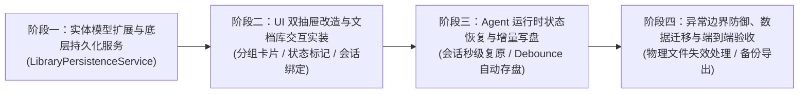

# 方案：基于「文件实体为中心」的本地持久化会话/上下文存储方案

> 
> 核心思路：**不再以聊天会话（ChatSession）作为唯一根实体，改成【文档集合 + 会话】双绑定模型**。
> 痛点现状：
> 
> 
> 1. 打开软件、上传文件，关闭重开后无任何历史；
> 2. 当前会话只在内存，未落地本地持久化；
> 3. 用户经常：打开同一组业务文件，继续上次针对这批文件的分析对话。

## 设计理念

传统聊天产品：`会话 → 消息列表`（会话是主体，文件只是会话附件）
你这个数据分析Agent更适合：**文档库（Document Library）为基础，会话绑定一组文档集合**

> 
> 业务场景：用户选中【销售2025.csv + 业务口径.pdf】，新建一个会话；下次打开软件，在文档库选中这两个文件，可以直接加载**针对这一组文档的历史对话**。

两种模式共存：

1. **独立会话模式**：普通自由对话，可以不带文件
2. **绑定文档组会话模式**：会话绑定一组DocumentItem，每次打开这组文档，自动检索关联会话。

---

# 1. 目录结构设计（本地上下文管理文件夹，放在 `%AppData%\DataAnalysis_Assistant\`）

> 
> 完全兼容你Unpackaged WinUI3，不使用`ApplicationData.Current`，沿用现有SettingsService存储位置。

```
%AppData%\DataAnalysis_Assistant\
├─ settings.json                    # 原有全局配置（Llm api、安全开关等，保留不变）
├─ scratch/                          # 临时Python产物、图表（已存在）
├─ library/                          # 文档库根目录（新增加）
│  ├─ documents/                     # 文档元数据记录（**原始文件不拷贝！只存元数据+提取文本缓存**）
│  │  └─ doc_meta_{DocId}.json       # DocumentItem序列化：文件路径、文件名、大小、提取文本、token预估、IsTabularData、SchemaProfile
│  ├─ document_groups/               # 文档组（一组关联文档，例如csv+pdf组合）
│  │  └─ group_{GroupId}.json        # Group元数据：GroupId，文档Id列表，创建时间，名称（用户可命名：Q3销售分析组）
│  └─ sessions/                      # 所有会话存储
│     ├─ session_{SessionId}.json    # ChatSessionItem + ChatMessageItem列表
│     └─ session_links/              # 【文档组 ↔ 会话】关联映射
│        └─ link_{GroupId}_{SessionId}.json
└─ cache/
   └─ schema_profiles/               # 缓存DataSchemaProfiler探查结果（避免重复解析大表格）
```

> 
> ⚠️ 重要原则：**原始用户文件不复制进AppData，只保存原始文件绝对路径！**
> 如果用户移动/删除原始文件，在UI标记文档「文件丢失」灰色，而不是复制大文件到程序目录，节省磁盘。
> 但是：文档解析后的`ExtractedText`、`SchemaProfile`**缓存保存在doc_meta json**，避免每次打开重复解析PDF/Excel。

## 2. 实体模型扩展（在你现有模型上增量修改，不推翻原有）

### 2.1 新增：DocumentGroup（文档组，核心新实体）

```
public class DocumentGroup
{
    public string GroupId { get; set; } = Guid.NewGuid().ToString();
    public string GroupName { get; set; } = ""; // 用户自定义名称，例如：Q3销售+业务口径
    public List<string> DocumentIds { get; set; } = new(); // 关联多个DocId，指向library/documents下的元数据
    public DateTime CreatedAt { get; set; } = DateTime.Now;
    public DateTime LastActiveAt { get; set; } = DateTime.Now;
}
```

### 2.2 修改已有实体

1. **DocumentItem**：增加唯一`DocId(Guid)`，序列化保存到`library/documents/doc_meta_{DocId}.json`
   - 保存：OriginalFilePath（原始文件绝对路径）、FileName、FileSize、ExtractedText、TokenEstimate、IsTabularData、SchemaProfile
2. **ChatSessionItem**：增加可选绑定字段

```
public class ChatSessionItem
{
    public string SessionId { get; set; } = Guid.NewGuid().ToString();
    public string? BindGroupId { get; set; } // 👉 关键：可选绑定到DocumentGroup；null=普通无文件会话
    public string SessionTitle { get; set; } = "";
    public DateTime CreatedAt { get; set; }
    public DateTime LastActiveAt { get; set; }
    public List<ChatMessageItem> Messages { get; set; } = new();
    // 保留原有其他字段
}
```

> 
> `BindGroupId` 可以为空，兼容不附加任何文档的纯对话。

### 2.3 关联关系

- 一个 **DocumentGroup**（一组文档）可以关联**多个会话**：比如针对同一套数据，做多轮不同方向分析：会话A做异常分析，会话B做趋势绘图研报。
- 一个会话只能绑定**0或1个DocumentGroup**。

---

# 3. 业务工作流（用户操作流程）

## 场景A：用户导入新文件，自动新建文档组与同名会话（全自动闭环）

1. 用户点击中栏左上角【选择文件】多选导入：支持导入一个或多个文件（例如 sales.csv + rule.pdf）
2. 系统生成对应 DocId 与 DocumentItem，保存元数据至 `library/documents/` 并提取内容/生成 Schema 骨架
3. 系统**自动创建文档组**包含选中文件：
   - 单文件导入：组名默认取去除后缀的文件名（例如 `sales` 或 `2026销售复盘`）
   - 多文件导入：组名默认取 `$"{首文件名} 等{文件总数}个文件"`（例如 `sales 等2个文件`）
4. 系统**自动新建关联会话**：
   - 会话标题（`Title`）与新文档组名称完全一致
   - 显式关联绑定 `BindGroupId = GroupId`，`BindGroupName = GroupName`
5. 工作区自动加载该组文件，中间板块展示首个文档，右侧自动就绪全新提问面板
6. 关闭软件后全部持久化在本地 AppData 目录中。

## 场景A-2：文档组双击与右键多会话管理
1. **左键双击文档组**：自动切换至【工作区文档】视角，完整呈现并高亮该文档组包含的所有文件，供用户直接查验或预览单文件；
2. **右键单击文档组**：弹出上下文菜单，选择【💬 基于此文档组新建对话】，支持同一个文档组建立多个独立会话（例如分别进行“异常数据核查”与“增长趋势预测”）。


## 场景B：重启软件，继续针对同一组文档的历史对话

1. 打开程序，加载`library`全部文档组列表，UI展示文档库
2. 用户选中文档组（sales.csv + rule.pdf）
3. 系统查询`session_links`，列出**所有绑定这个GroupId的历史会话**
4. 用户选择历史会话 → 加载该会话全部ChatMessage，自动加载文档组内全部DocumentItem，挂载到Agent运行上下文
5. Agent恢复上下文，继续上一轮数据分析任务，包含历史工具调用、Python执行结果、图表artifact记录

## 场景C：普通对话，不带文档

- BindGroupId=null，会话独立保存，不绑定任何文档。

## 场景D：文档移动/删除保护机制

- 读取DocumentItem时，校验`OriginalFilePath`文件是否存在
- UI标记：✅正常 / ⚠️原始文件缺失
- 文档元数据、提取文本缓存仍然保留；用户可以重新选择文件重新关联DocId，不用重新解析。

# 4. 服务层新增：LibraryPersistenceService（文档库+会话持久化服务）

职责：

1. 读写DocumentItem元数据，缓存解析后的文本和SchemaProfile
2. 管理DocumentGroup的CRUD
3. ChatSession的持久化、加载、按GroupId查询会话
4. 自动清理策略：可选清理过期scratch图表缓存，不删除用户会话/文档元数据

对外暴露核心API：

```
// 文档相关
Task<DocumentItem> SaveDocumentMetaAsync(DocumentItem doc);
Task<DocumentItem?> LoadDocumentAsync(string docId);

// 文档组
Task<DocumentGroup> CreateDocumentGroupAsync(string name, IEnumerable<string> docIds);
Task<List<DocumentGroup>> ListAllGroupsAsync();
Task<List<ChatSessionItem>> GetSessionsByGroupIdAsync(string groupId);

// 会话持久化
Task SaveSessionAsync(ChatSessionItem session);
Task<ChatSessionItem?> LoadSessionAsync(string sessionId);
Task<List<ChatSessionItem>> ListAllSessionsAsync();
```

> 
> 和你原有SettingsService解耦：SettingsService只负责全局配置；LibraryPersistenceService专门管理文档库+会话。

# 5. 和你Agentic Harness运行时的整合要点

## 5.1 加载会话时自动组装Agent上下文

当加载一个绑定`BindGroupId`的会话：

1. 通过GroupId拿到全部DocId列表
2. 批量LoadDocumentAsync拿到全部DocumentItem（包含缓存好ExtractedText和SchemaProfile）
3. 把文档集合 + 历史ChatMessage一并送入`AgentQueryLoopService`，恢复Agent运行状态
4. ContextCompactionService正常执行上下文压缩，保留事实锚点（符合你第五阶段保真规则）

> 
> 历史消息内包含：用户提问、LLM思考、ToolCall、ToolExecutionResult、生成的Artifact（图片路径）。
> 也就是说，上次Python执行返回的结果、生成的图表记录，全部保存在ChatMessageItem，重开软件不会丢失工具执行历史。

## 5.2 Agent执行过程自动持久化

每一轮Agent工具循环（每次tool执行完成、收到LLM回复）**增量保存会话json**，防止程序崩溃丢失对话。

> 
> 不要等整个任务跑完再保存，每一步更新就写磁盘。

## 5.3 SchemaProfile缓存优化

`DataSchemaProfiler`探查大表很耗IO，把探查结果缓存到`cache/schema_profiles/{DocId}.json`
下次打开同一份表格文档，直接读取缓存，**不需要重新扫描全表生成schema**。

# 6. UI侧改造方案（适配你现有界面）

1. 左侧导航抽屉新增「文档库」面板
   - 展示文档组列表（每个组展示包含哪些文件、最后活跃时间）
   - 选中文档组，右侧展示**关联历史会话列表**
2. 文档预览区：加载文档组内所有文档
3. 聊天面板：打开绑定文档组的会话时，自动挂载本组全部文档到当前Agent上下文
4. 文档导入弹窗：导入多个文件后，提供【新建文档组】快捷按钮
5. 文档项增加状态标记：原始文件存在/文件丢失

# 7. 可选优化策略 & 边界问题处理

## 7.1 增量保存与性能

会话json会随对话轮次不断变大。
方案：json直接序列化没问题；超大会话可做**消息分页存储**（拆成session_xxx_part1.json），初期可以先单文件实现，后续迭代。

## 7.2 重复导入相同文件的去重

根据文件全路径+文件哈希（MD5）判断，同一个文件多次导入，**复用同一个DocId**，避免重复存储解析文本缓存。

> 
> 可选：读取文件MD5作为辅助标识，防止同路径但文件内容变更。

## 7.3 导出/导入会话备份

LibraryPersistenceService增加备份接口：导出整个文档组+绑定会话为zip包，可以迁移到另一台电脑。

## 7.4 清理策略（用户可控，后台不自动删除用户会话）

scratch临时图片、缓存schema可以设置自动清理；**文档元数据、会话消息永远不后台自动删除，只能用户手动删除文档组/会话**。

# 8. 方案对比（两种可选路线，上面是推荐路线）

## 路线A【推荐，当前方案】：文档组为中心，会话绑定文档组 ✅

优点：

- 完美匹配你的数据分析场景：用户就是**固定一组文档反复做多轮分析**
- 历史对话天然和文件绑定，打开文件就看到对应的分析历史
- 完全兼容现有Agentic Harness、CodeAct、上下文保真机制
- 实体增量扩展，原有ChatSessionItem改动极小，不推翻已有代码
缺点：需要新增DocumentGroup实体、LibraryPersistenceService，少量UI改造

## 路线B（简单但不推荐）：会话内直接嵌入文档列表

> 
> 在ChatSessionItem内部保存DocumentId列表，不单独抽象DocumentGroup
> 缺点：

- 多个会话使用同一套文件，会重复存储文档id，无法批量管理文档集合；
- 用户无法单独在文档库浏览文件，只能在会话里看到附件；
- 不符合你的业务：用户需要文档库，提前管理一批业务文档，再选择做分析。

# 9. 写入PRD的新增章节（直接复制进你的架构文档末尾）

```
## 七、本地持久化文档库与会话管理模块（新增模块）
### 7.1 设计目标
解决当前无本地持久化存储，重启软件后文档、对话历史全部丢失的问题。
采用**文档组为中心**的持久化模型：用户可以把多个关联文档（CSV+PDF+Word）打包成文档组；会话可以绑定到文档组，打开文档组即可加载所有关联历史Agent对话，完整恢复历史工具调用、Python执行日志、图表Artifact与上下文状态。
> 核心原则：原始用户文件不复制到AppData目录，仅存储文件路径、文档解析文本缓存、Schema探查缓存、会话消息。

### 7.2 目录存储结构
所有持久化文件存放于 `%AppData%\DataAnalysis_Assistant\library/`
```

library/
├─ documents/                # 文档元数据缓存 DocMeta_{DocId}.json
├─ document_groups/          # 文档组定义 group_{GroupId}.json
└─ sessions/                 # 会话存储 session_{SessionId}.json
cache/schema_profiles/        # DataSchemaProfiler表结构探查缓存

```

### 7.3 实体扩展定义
1. DocumentItem：新增唯一DocId(Guid)，持久化存储解析后的ExtractedText，SchemaProfile，原始文件路径。
2. DocumentGroup（新增）：一组关联文档集合，包含GroupId，文档Id列表、名称、创建/最后活跃时间。
3. ChatSessionItem：新增可选BindGroupId字段，用于绑定文档组；BindGroupId=null代表无附件独立会话。

### 7.4 LibraryPersistenceService 持久化服务职责
- 文档元数据CRUD，解析文本缓存；
- 文档组CRUD；
- ChatSession持久化读写，支持按GroupId查询关联会话；
- 缓存管理：数据表SchemaProfile缓存，避免重复探查大文件；
- 文件状态校验：检测原始文件是否存在，UI标记文件丢失状态。

### 7.5 业务工作流
1. 用户导入多个文件 → 生成DocumentItem并保存元数据；
2. 用户创建文档组，选中导入的文档；新建Agent会话并绑定BindGroupId；
3. Agent每轮工具执行、LLM回复，**增量持久化会话JSON**；
4. 重启应用，进入文档库选中文档组，加载绑定的历史会话；自动加载本组全部文档元数据，恢复Agent上下文、历史工具调用记录、图表产物引用；
5. 若原始文件被移动或删除，UI标记文件缺失，保留缓存文本和历史会话，支持重新关联文件。

### 7.6 与Agent Runtime整合规则
1. 加载绑定文档组的会话时，自动读取组内全部DocumentItem，送入AgentQueryLoop上下文；
2. 历史ToolExecutionResult、生成图表Artifact路径，随ChatMessageItem一起持久化；
3. 上下文压缩服务ContextCompactionService继续遵守原有数据保真铁律，加载历史会话后恢复事实锚点；
4. 每次Agent循环步骤完成，立即写盘保存会话，防止程序崩溃丢失进度。

### 7.7 UI改造范围
- 左侧导航抽屉新增文档库面板；
- 文档组列表展示，选中文档组展示关联历史会话；
- 文档状态标记：正常 / 原始文件丢失；
- 文档导入界面增加「新建文档组」快捷操作。

### 7.8 约束
- 不拷贝原始用户文件，仅保存文件绝对路径；
- 用户会话与文档元数据不会后台自动删除，仅scratch临时产物可配置自动清理；
- 支持同一份原始文件被加入多个不同文档组，DocId全局唯一，解析文本只缓存一次。
```

---

# 10. 分阶段具体实施规划与落地路线图 (Phase-by-Phase Execution Plan)

为确保工程落地稳健有序、与已有 5 大阶段的 Agentic 体系平滑兼容，本模块拆分为 **4 个渐进式实施阶段**（遵循“先底层数据与持久化引擎 -> 再 UI 双抽屉交互 -> 继而 Agent 运行时双向恢复与增量写盘 -> 最后全局容错与全流程验收”的工程演进路径）：



---

### 阶段一：实体模型扩展与持久化底层服务引擎 (Foundation & Persistence Engine)

- **定位与目标**：
  - 建立“文档（DocumentItem）+ 文档组（DocumentGroup）+ 会话（ChatSessionItem）”持久化底层基础；
  - 实现纯 C# 服务层与 JSON 序列化读写，不涉及前端 UI 变动，确保单元自洽与 0 编译错误。
- **具体实施内容**：
  1. **实体模型扩展**：
     - 新建 `Models/DocumentGroup.cs`：包含 `GroupId` (GUID)、`GroupName`、`DocumentIds` 集合、创建与活跃时间戳；
     - 扩展 `Models/DocumentItem.cs`：增加唯一主键 `DocId`，支持原文字节级文本与 `SchemaProfile` 的无损序列化；
     - 扩展 `Models/ChatSessionItem.cs`：增加唯一主键 `SessionId`、可选绑定外键 `BindGroupId`、`CreatedAt`、`LastActiveAt` 及全量 `List<ChatMessageItem> Messages`；
     - 增加 UI 序列化防护：在 `ChartArtifactItem.Bitmap` 等 UI 资源属性上显式标记 `[JsonIgnore]`，防止 `System.Text.Json` 在跨线程或反序列化时报错。
  2. **构建持久化服务引擎 `Services/Persistence/LibraryPersistenceService.cs`**：
     - 统一根存储目录定位于 `%AppData%\DataAnalysis_Assistant\library\`（规范子目录：`documents/`、`document_groups/`、`sessions/`、`cache/schema_profiles/`）；
     - 实现文档元数据 CRUD（`SaveDocumentMetaAsync`、`LoadDocumentMetaAsync`、`ListAllDocumentsAsync`）；
     - 实现文档组 CRUD（`CreateGroupAsync`、`UpdateGroupAsync`、`DeleteGroupAsync`、`ListAllGroupsAsync`）；
     - 实现会话存储与关联映射（`SaveSessionAsync`、`LoadSessionAsync`、`GetSessionsByGroupIdAsync`、`DeleteSessionAsync`）；
     - 文件物理探查：提供 `CheckDocumentFileExists(doc)` 物理存在性核验接口。
- **阶段交付物**：
  - `Models/DocumentGroup.cs`：文档组核心实体；
  - `Models/DocumentItem.cs`（增量扩展 `DocId`）；
  - `Models/ChatSessionItem.cs`（增量扩展 `SessionId`、`BindGroupId`、`Messages`）；
  - `Models/ChartArtifactItem.cs`（标记 `[JsonIgnore]` 防崩溃）；
  - `Services/Persistence/LibraryPersistenceService.cs`：文档库与会话持久化核心服务。
- **验收标准 (DoD)**：
  - 执行 `dotnet build` 确保 0 警告 0 错误；
  - 自动化/集成测试中成功在 `%AppData%` 下创建对应目录层级，写入并读取文档组与会话 JSON，数据往返反序列化无损。

---

### 阶段二：UI 双抽屉改造与文档库交互实装 (Presentation & Management UI)

- **定位与目标**：
  - 彻底打通左侧导航栏【文档库】抽屉（`paneDocLibrary`）与【历史会话】抽屉（`paneHistorySessions`）的真实数据源；
  - 摆脱过去的静态占位模拟数据，呈现真实可管理的文档组、文档物理状态以及关联历史会话。
- **具体实施内容**：
  1. **重构文档库抽屉 (`paneDocLibrary`)**：
     - 数据源绑定持久化的 `ObservableCollection<DocumentGroup>` 与 `ObservableCollection<DocumentItem>`；
     - 提供“按文档组浏览”与“全部文档”双重视角卡片，展示组内文件构成、规模与最后活跃时间；
     - 在 UI 上清晰呈现文档物理状态指示：✅ 正常绿色角标 / ⚠️ 原始文件丢失（原绝对路径不存在）黄色警告徽标；
     - 提供基础管理动作：【新建文档组】、【重命名组】、【从组内移除】、【重新定位原始路径】（针对失效文档）。
  2. **重构历史会话抽屉 (`paneHistorySessions`)**：
     - 真实绑定从本地加载的 `ObservableCollection<ChatSessionItem>`；
     - 卡片增加附属信息展示：显示最后活跃时间，以及该会话所绑定的【文档组徽标】（如 `[财务2025组]` 或 `[独立会话]`）；
     - 点击会话触发加载事件，提供会话重命名与删除确认弹窗。
  3. **主界面导入交互衔接**：
     - 用户点击顶部【选择文件】多选导入后，在文档列表顶栏增加【📦 打包为新文档组】快捷操作胶囊，一步完成建组并绑定当前对话。
- **阶段交付物**：
  - `MainWindow.xaml`（重构 `paneDocLibrary`、`paneHistorySessions` 数据模板与状态徽标）；
  - `MainWindow.xaml.cs`（实现文档组管理事件、会话切换事件与物理路径有效性校验）。
- **验收标准 (DoD)**：
  - 用户导入文件后可成功创建“文档组”并持久化；
  - 关闭软件并重启后，左侧抽屉能完整加载上次创建的文档组与文件清单；
  - 移动本地测试文件后，UI 准确标识警告状态并允许重新定位。

---

### 阶段三：Agent 运行时状态恢复与增量持久化 (Runtime Sync & Ground-Truth Context)

- **定位与目标**：
  - 实现历史会话加载时 Agent 上下文的“原貌秒级恢复”（含思考链路、内嵌图表与工具历史）；
  - 实现 Agent 多步推理过程中的“防崩溃增量自动存盘”，杜绝用户分析中途程序意外退出导致结果丢失。
- **具体实施内容**：
  1. **会话秒级还原与上下文挂载**：
     - 当用户在历史列表中选中某一会话时：
       1. 通过 `LibraryPersistenceService` 读取完整会话消息流；
       2. 还原界面消息气泡，复原折叠思考卡片、内嵌高清图表画廊与最终研报正文；
       3. 检查其 `BindGroupId`，极速还原该组所有 `DocumentItem` 的提取文本与 `SchemaProfile`（直接命中本地 JSON 缓存，零耗时加载）；
       4. 将组内文档注入当前工作区及 `AgentQueryLoopService` 上下文，用户可直接接续上一轮任务继续追问或扩展分析。
  2. **防卡顿增量写盘机制 (Debounce & Step-Level Persistence)**：
     - 严格避免在毫秒级打字机流式字符回调中频繁读写磁盘；
     - 确定关键持久化触发时机：
       - 用户发送新问题时（立即持久化写入一条新用户消息）；
       - 每次 Tool 执行结束时（持久化工具调用与执行反馈）；
       - Agent 最终结论完成输出或用户点击【停止】中断时（写入完整总结并更新会话活跃时间）；
     - 采用异步后台无阻塞写盘，不卡死 UI 消息泵。
  3. **数据表 Schema 探查极速缓存结合**：
     - 对接阶段四的 `DataSchemaProfiler`，探查结果落地持久化至 `cache/schema_profiles/{DocId}.json`；
     - 无论用户何时重开大型 CSV/Excel，瞬时加载骨架，不再重复消耗磁盘扫描十万行大表。
- **阶段交付物**：
  - `MainWindow.xaml.cs`（接入会话加载生命周期、文档组自动挂载与增量写盘调度）；
  - `Services/Agent/AgentQueryLoopService.cs`（配合各轮执行后的异步进度持久化通知）；
  - `Services/Data/DataSchemaProfiler.cs`（结合 Schema 本地磁盘缓存策略）。
- **验收标准 (DoD)**：
  - 打开带多轮工具调用与多张图表的历史会话，历史消息流 100% 完整复原，图表可正常点击全屏放大；
  - 会话恢复后，继续提问“请根据上述第三个指标做进一步方差分析”，Agent 能准确感知前情上下文，流畅接续分析并生成新图表。

---

### 阶段四：异常边界防御、数据迁移与端到端验收 (Verification & Polish)

- **定位与目标**：
  - 处理文件并发访问、磁盘满、脏数据熔断等边界异常；
  - 保证系统在极端使用环境下的健壮性与极致用户体验，完成项目全局交付验收。
- **具体实施内容**：
  1. **并发与文件损坏防御**：
     - 使用 `SemaphoreSlim` 为每个会话/文档 JSON 读写添加异步锁，杜绝多任务并发写入引发的 `IOException`；
     - 读取本地持久化 JSON 时增加容错熔断（Try-Catch），若遇到空文件或语法损毁文件，优雅提示并隔离为备份文件（`.bak`），杜绝启动闪退。
  2. **原始文件缺失下的 Agent 智能降级**：
     - 当会话关联的某个底层文件缺失且用户未重定位时：
       - 若进行纯文本/规章条款问答，Agent 直接利用已缓存的 `ExtractedText` 正常回答；
       - 若需要运行 Python 代码读取该文件，系统提前向模型注入“文件路径暂不可达”的提示，并引导用户重新定位文件，杜绝模型进入 Python `FileNotFoundError` 的盲目重试死循环。
  3. **数据导入导出备份（可选增强）**：
     - 在文档库提供【导出文档组备份包 (.zip)】与【导入备份包】功能，方便跨机器或团队协作共享整套分析资产。
  4. **全量构建与质量验收**：
     - 执行 `dotnet build` 确保 **0 警告 0 错误**；
     - 检查工作区整洁纪律，过程数据一律收容于 `%AppData%\DataAnalysis_Assistant\`，保持工程目录清爽。
- **阶段交付物**：
  - 完善的异常保护机制与并发读写锁；
  - 更新项目发布文档与用户使用指引；
  - 全套功能通过端到端闭环验证。
- **验收标准 (DoD)**：
  - 模拟各种极端场景（强制结束进程、断网、移动源文件、删除单条会话），软件稳定运行不崩溃；
  - 全流程验证通过：创建文档组 -> 发起多轮 CodeAct 分析与绘图 -> 导出 Word 研报 -> 退出软件重启 -> 文档库秒级复原会话并接续提问。

---

### 阶段五：文档组交互全自动闭环、多会话支持、画廊横向滚动与排版修复 (Interaction Polish & Automation)

- **定位与目标**：
  - 彻底打通“导入文件 ➔ 自动成组 ➔ 自动新建同名会话”的单向全自动流水线，清除繁琐手动建组步骤；
  - 简化抽屉管理界面，删除冗余操作按钮，提供符合直觉的双击跳转与右键多会话创建体验；
  - 解决可视化界面在小窗口下的排版重叠 Bug，并实现图表历史画廊的丝滑横向滚动。
- **具体实施内容**：
  1. **【选择文件】自动成组与同名对话新建**：
     - 用户点击中栏左上角【选择文件】（支持多选导入 1 个及以上文件）；
     - 自动检测并解析文件文本与表格 Schema 骨架；
     - 自动依据文件名生成新文档组（单文件：文件名去后缀；多文件：`$"{首文件名} 等{总数}个文件"`）；
     - 自动创建同名新会话（`Title = GroupName`，`BindGroupId = GroupId`），清空并就绪右侧对话流；
     - 工作区自动同步载入该组文件，中间看板默认展示首个文档内容。
  2. **抽屉面板操作清理与文档组快捷交互**：
     - 删除【文档组管理】上方的【新建文档组】与【打包当前文件】按钮栏；
     - 删除【工作区文档】上方的【选择本地文档】按钮栏，保留顶部搜索框与纯粹的文档列表；
     - 文档组列表支持**鼠标左键双击**：自动切换至【工作区文档】视图，完整且正确呈现当前双击文档组包含的所有文件并激活首个文档预览；
     - 文档组列表支持**鼠标右键单击**：弹出 `MenuFlyout` 上下文菜单，提供【💬 基于此文档组新建对话】（支持一个文档组建立多个独立会话，自动按序或区分命名）、【✏️ 重命名】与【🗑️ 删除文档组】。
  3. **小比例下【可视化】界面显示重叠修复**：
     - 重构 `gridVisualizationView` 底栏布局为双列 Grid（左列自适应星号 `*`，右列 `Auto`）；
     - 左侧 `tbVisInsightTip` 开启 `TextTrimming="CharacterEllipsis"`、`TextWrapping="NoWrap"`，并配置悬浮 ToolTip；
     - 右侧操作按钮固定靠右独立呈现，彻底杜绝任何窄屏/小窗口下的文本与按钮交叉覆盖。
  4. **【可视化界面】历史画廊支持横向滚动**：
     - 为 `lvPlotGallery` 配置 `ScrollViewer.HorizontalScrollBarVisibility="Auto"` 与 `ScrollViewer.HorizontalScrollMode="Enabled"`；
     - 挂载鼠标滚轮事件监听（`PointerWheelChanged`），将滚轮垂直滚动量无缝转换为水平平移（`ChangeView`），同时完美兼容触控板左右滑动手势。
- **阶段交付物**：
  - `MainWindow.xaml`（完成按钮精简、右键菜单、双列自适应底栏及画廊水平滚动条配置）；
  - `MainWindow.xaml.cs`（实现自动成组+同名会话、双击跳工作区、右键新建多会话及画廊滚轮横向滑动调度）；
  - `ContentManagement_Target.md`（完整同步最新交互规范）。
- **验收标准 (DoD)**：
  - 中栏左上角选择 1 个或多个文件后，自动生成新文档组并自动新建同名会话，无需任何额外手动打包操作；
  - 双击任一文档组，自动切换到【工作区文档】且仅显示该组文件；
  - 右键任一文档组，点击【基于此文档组新建对话】，成功生成绑定该组的新独立会话，可建立多个会话；
  - 缩放到最小窗口比例，可视化界面底栏文字优雅截断省略，按钮清晰完整，无任何重叠；
  - 历史画廊可直接使用鼠标滚轮横向滚动；
  - 全工程编译通过（0 警告 0 错误）。

---

> ✅ **当前状态说明**：本计划【阶段一】至【阶段四】已全部验收上线；【阶段五：文档组交互全自动闭环、多会话支持、画廊横向滚动与排版修复】现已进入正式执行与代码落地阶段。
