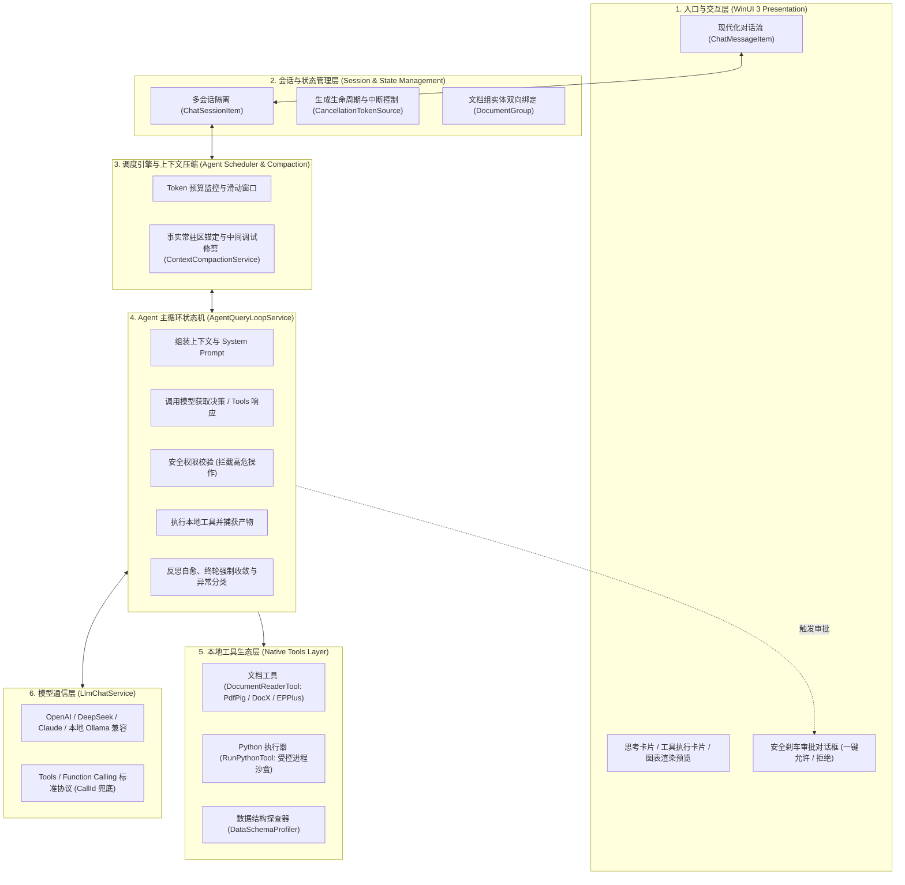
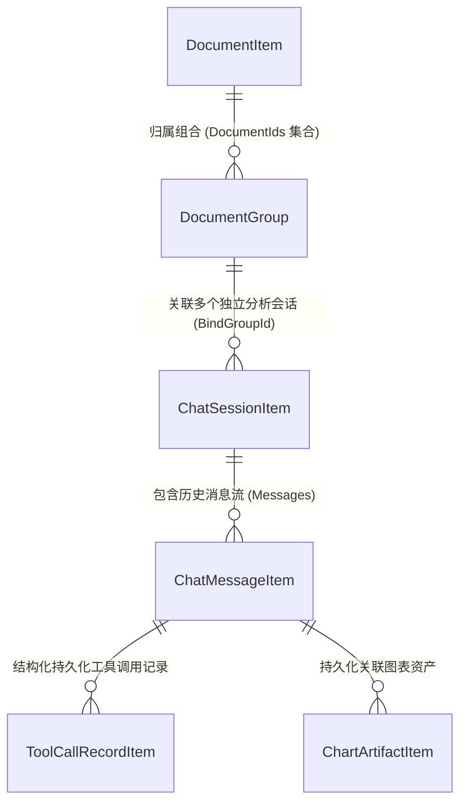
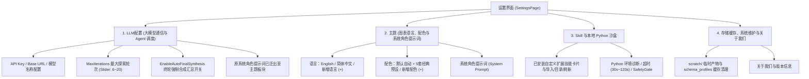

# Data Analysis Assistant 项目需求及设计文档

> **项目核心定位**：基于 WinUI 3 (Windows App SDK) + .NET 8 构建的专业桌面级本地智能数据分析与业务文档综合研报助手。系统深度融合 **CodeAct (Code-as-Action)** 与 **Agentic Harness** 编排体系，提供跨文档深度推演、本地安全代码执行、动态图表渲染、自检反思闭环与专业 Word/Markdown 研报导出能力。

---

## 一、UI设计

### 1.左侧导航栏
左侧导航栏基于 Windows 11 Fluent Design 双抽屉面板设计，是用户管理数据资产（文档组）与知识资产（会话记录）的核心中枢：

- **1.1 文档库管理抽屉 (`paneDocLibrary`)**：
  - **文档组卡片管理**：以“文档组”为核心业务实体展示关联文件集合（如 `sales 等2个文件`），卡片直观呈现组内文件构成、总体积与最后活跃时间。
  - **工作区文档平铺视角**：支持检索过滤当前激活文档组所包含的全部单文件。
  - **源文件物理状态指示**：
    - `✅ 正常`（绿色徽标）：本地文件路径有效可达；
    - `⚠️ 文件缺失`（黄色警告徽标）：若用户在外部磁盘移动或删除了源文件，UI 自动标记警告，保留本地缓存文本与 Schema 骨架，并支持右键【重新定位原始路径】。
  - **手势与快捷交互**：
    - **鼠标左键双击文档组**：自动切换中栏视图至【工作区文档】视角，高亮并完整呈现该组包含的所有文件，同时在中间栏自动激活预览首个文件；
    - **鼠标右键单击文档组**：呼出上下文菜单，提供【💬 基于此文档组新建对话】（支持针对同一套数据创建多个独立分析方向的会话，如“异常核查”、“增长预测”）、【✏️ 重命名文档组】与【🗑️ 删除文档组】。
- **1.2 历史会话管理抽屉 (`paneHistorySessions`)**：
  - **真实数据源绑定**：完整绑定 `%AppData%\DataAnalysis_Assistant\document_groups/{groupId}/sessions/` 本地持久化会话；
  - **文档组关联徽标**：会话卡片上直观显示其绑定的文档组名称标签（如 `[财务2025组]` 或 `[独立会话]`）；
  - **会话维护**：支持单击无缝切换会话、双击修改会话标题、右键删除会话二次确认。

---

### 2.中间预览栏

#### 2.1.文档工作区与数据预览 (`gridDocPreviewView`)
- **多格式全自动解析引擎**：
  - **表格数据 (CSV / Excel .xlsx, .xls)**：自动嗅探 Windows 中文编码（GB18030 / UTF-8）与分隔符，借助 `DataSchemaProfiler` 展现字段名、数据类型、缺失率与紧凑网格分页预览；
  - **PDF 电子文档**：基于 `PdfPig` 管道呈现提取文本与章节大纲导航；
  - **Word 研报 (.docx)**：基于 `DocX` 解析多级标题层级与正文；
  - **纯文本与代码 (.txt, .py, .json, .md)**：等宽字体着色呈现。
- **【选择文件】全自动闭环工作流**：
  - 位于中栏左上角的核心操作入口，支持单选或多选批量导入；
  - **全自动流水线**：点击选择文件 ➔ 后台自动解析文本与生成 Schema 骨架 ➔ 自动依据文件名创建文档组（单文件去后缀，多文件按 `$"{首文件名} 等{总数}个文件"`） ➔ 自动新建同名会话并显式关联 ➔ 工作区自动同步载入，中间预览首个文档，右侧就绪提问面板，全程无需繁琐手动建组。

#### 2.2.可视化 (`gridVisualizationView`)
- **2.2.1 动态大屏看板展示**：
  - **主图大屏展示区**：展示当前激活的高清统计图表，提供平滑过渡效果；
  - **自适应双列底栏排版**：
    - 左列（自适应星号 `*`）：展示图表元数据与解读提示，开启 `TextTrimming="CharacterEllipsis"` 与 `TextWrapping="NoWrap"`，并配置悬浮 `ToolTip`，窄屏下绝不与右侧重叠；
    - 右侧操作栏（固定紧凑靠右）：严格遵守纯文本规范，提供【导出研报】、【放大】、【复制】、【另存为】四个纯净按钮。
- **2.2.2 历史图表画廊 (`lvPlotGallery`)**：
  - **水平画廊排列**：以缩略图形式横向陈列本会话生成的所有图表产物；
  - **鼠标滚轮横向平移**：挂载 `PointerWheelChanged` 事件，将鼠标纵向滚轮滚动量无缝转换为水平平移（`ChangeView`），同时原生兼容笔记本触控板左右滑动手势；
  - **状态高亮联动**：点击任意缩略图，大屏看板即刻无缝切换呈现该图。
- **2.2.3 全局模态大图查看器 (`gridPlotImageViewer`)**：
  - **默认居中尺寸与位置重置**：
    - 每次打开查看器，窗口**严格以默认 $1050 \times 720$ 尺寸在屏幕正中展开**；
    - **不记忆上次关闭前拉伸调整过的宽高与全屏状态**，杜绝窗口异形残留。
  - **100% 完整展示整图算法 (Fit to Viewport)**：
    - 计算视口可用尺寸与图片物理自然尺寸的缩放比例：
      $$\text{FitScale} = \min\left(\frac{\text{ViewportWidth} - 28}{\text{NaturalWidth}}, \;\frac{\text{ViewportHeight} - 28}{\text{NaturalHeight}}\right)$$
    - 打开时、图片解码就绪时（`ImageOpened`）、视口拉伸时及点击复位比例按钮时，自动适屏居中，四周预留舒适呼吸内边距，彻底杜绝图表被局部裁剪截断。
  - **透明边角热区与 Windows 原生双向拉伸光标**：
    - 界面本身没有任何可见文字、方块或图标抓手；
    - 左下角与右下角各布置 `36×36` 像素的纯透明感应热区（`Background="Transparent"`）；
    - 鼠标移入时由 WinUI 3 `ProtectedCursor` 机制直接呈现 Windows 原生拉伸光标：
      - **右下角**：`InputSystemCursorShape.SizeNorthwestSoutheast`（$\nwsearrow$）
      - **左下角**：`InputSystemCursorShape.SizeNortheastSouthwest`（$\ne-sw$）
    - **1:1 绝对中心跟手拉伸**：采用几何中心对称算法（$\text{Width} = 2 \times |\text{MouseX} - \text{CenterX}|$），卡片边缘实时精准紧贴鼠标指针尖端，无任何滞后延迟。
  - **画布自由拖动平移 (Pan)**：
    - 按住 Ctrl 配合滚轮平滑缩放到细节（0.2x ~ 5.0x）；
    - 放大状态下，鼠标在画布区域呈现抓手光标（Hand），按住鼠标左键即可 1:1 自由拖动画布平移视口。
  - **物理分列顶栏防重叠**：
    - 顶栏左侧图表标题与绝对文件路径设置自适应星号列与省略号截断（`TextTrimming="CharacterEllipsis"`），带悬浮 ToolTip；
    - 右侧紧凑固定操作栏：【在资源管理器中打开】、【100%】（点击复位）、【全屏】（全屏/还原切换）、【关闭】。
  - **操作按钮纯文本规范红线**：
    - 彻底移除弹窗右下角冗余的【复制图片】与【另存为】按钮，垂直空间全量让渡给高清大图；
    - 所有按钮文字采用严谨纯文本，**严禁携带任何 Emoji 或装饰性图标**。

---

### 3.右侧AI对话栏
- **3.1 现代化对话流呈现**：
  - 气泡布局支持 Markdown 排版、LaTeX 数学公式渲染、数据表格与代码高亮块；
  - **推演链路折叠卡片 (Reasoning / Thinking)**：深度推理内容默认收拢在圆角卡片中，呈现 `💭 深度思考 (耗时 X 秒)` 摘要，展开后展示模型推导心路（底层剥离工具流水账）；
  - **工具调用卡片 (Tool Execution Cards)**：清晰展示 Agent 发起的工具调用名称（如 `run_python`、`read_document`），展开展示入参代码与输出摘要；
  - **多模态图表内嵌卡片**：生成的统计图表直接在消息流内嵌高清缩略图，单击唤起大图查看器。
- **3.2 Slash Command (`/`) 技能扩展交互体系**：
  - **浮层呼出与模糊检索**：输入框键入 `/` 触发上拉面板（`popupSkillSelector`），陈列已安装技能（代码图标、加粗名称、浅灰描述），支持键盘上下键导航、回车/Tab 选中、Esc 关闭；
  - **技能胶囊卡片 (Pill)**：选中后自动擦除 `/`，生成 `[ </> 技能名 ✕ ]` 胶囊卡片，光标无缝继续输入提问，支持点击 `✕` 或 Backspace 移除。
- **3.3 研报一键专业级导出**：
  - 消息气泡与大屏看板均提供【导出研报】功能；
  - **专业 Word 研报 (.docx)**：排版包含文档封面大标题、生成时间、分析师签名栏、Markdown 标题映射、专业数据表格、代码高亮框及内嵌高清居中图表；
  - **标准 Markdown 研报 (.md)**：标准 Frontmatter 元数据与图表本地引用语法。
- **3.4 交互中断控制**：配备就地【停止】按钮，点击即刻通过 `CancellationToken` 打断推演。

---

### 详细执行计划详见 [UI设计](./docs/UI_Design.md)

---

## 二、AI对话与Tools执行架构设计

系统构建了一套运行在 Windows 桌面端的 **Agentic Harness 6层智能体分层架构**：



### 1. 核心保障：数据完整性与零幻觉策略 (Code-to-Data)
- **计算下推准则（数据不动代码动）**：原始大数据（无论十万行还是数百万行）始终 100% 完整留存于本地磁盘或内存中，**绝不粗暴截断前 50 行塞入 Prompt**；模型仅编写 Python 脚本下推至本地进程运算，回传精确真值。
- **Schema-First 机制**：由 `DataSchemaProfiler` 先向模型提供字段名、类型、极值与前 5 行样例的骨架视图，以极小 Token 换取全局数据宏观认知。
- **非结构化文档高保真按需检索 (Precision Chunking)**：PDF/Word 先解析大纲目录，定位章节后**按需原文字节级无损提取**（零截断、零压缩）。
- **上下文压缩安全边界**：允许压缩淘汰调试代码与报错 Traceback；**严禁压缩业务口径原文、全量聚合事实表（Ground-Truth Metrics）与原始任务约束**。
- **确定性断言与证据链闭环**：研报关键结论与 Python 计算真值正则核验比对，杜绝幻觉。

### 2. 本地工具生态与产物捕获闭环
- **本地工具生态**：`RunPythonTool`（受控子进程）、`DocumentReaderTool`（多格式无损阅读）、`DataSchemaProfiler`（大表秒级探查）。
- **增强型 Matplotlib 双向全接口 Monkey-Patch**：同时 Hook 过程式 `plt.savefig` 与面向对象 `Figure.savefig`，自动按 `原名_时间戳_短UUID.ext` 镜像一份至 `agent_sandbox/` 并输出标记。
- **遗留资产动态扫描回收**：脚本执行完毕后对比 `scratch/` 根目录增量文件，自动搬运遗留图表至沙盒，确保图表 100% 捕获至前端画廊。

### 3. 专属受控用户 Skill 扩展与 Slash Command 深度注入
- **专属目录锁定**：仅允许从 `%APPDATA%\DataAnalysis_Assistant\skills` 检索用户技能，彻底杜绝全局目录泛滥扫描；
- **Prompt 深度注入与沙盒边界隔离**：读取 `SKILL.md` 规约全文注入大模型，并显式注入【系统受控沙盒环境边界约束】警告，严禁大模型调用代码检索技能内部 `manifest.yaml` 等元文件，根除沙盒死循环。

### 4. 图表主题提示词动态注入（语言与配色）
- **纯 Prompt 注入机制**：在 `LlmChatService.BuildMessagesPayload` 组装 `System Message` 时，实时读取 `settings.json` 中选中的图表语言与结构化 Hex 配色方案并动态拼装注入，不改动 `PythonExecutionService` 的 `rcParams` 硬注入，对下一条发送的对话消息立即生效；
- **严格作用域边界**：主题中的【语言】与【配色】仅约束 Python 生成的统计图表（标题、副标题、坐标轴名称、刻度、图例、数据标签及色板/视觉风格），对话分析正文语言仍跟随用户提问语言与系统角色提示词；
- **四级优先级裁决**：冲突处理严格遵循 `用户当次提问显式要求 > 通过 / 启用的 Skill 专属规范 > 主题全局设置（语言/配色） > 默认系统提示词`。

### 5. 调度状态机、收敛与全链路故障治理
- **CancellationToken 绝对硬打断**：用户点击停止时立即退出主循环，坚决不发起终轮大模型调用；
- **终轮双状态强制收敛**：达到最大轮次（默认 12 轮，UI 可调 6-20 轮）时，协议层设置 `tool_choice="none"` 并在代码层直接丢弃 `tool_calls`，确保强制输出全量研报；
- **执行分级超时与 heavy_work**：基准超时放宽至 60s（UI 可调 30s-120s，代码施加 `Math.Max(60, ...)` 保底），大表计算支持声明 `heavy_work: boolean`；
- **协议链路 CallId 自动补齐**：响应缺失 `id` 时自动兜底 `call_{guid}`，多轮追问完整重建 `assistant(tool_calls)` 与 `tool` 回合；
- **防重复重绘与正文裂图根治**：工具成功注入 `[ARTIFACT_CONFIRMED]` 阻断无意义重绘，严禁 Markdown 正文输出相对路径图片语法；
- **时序竞态消除**：后台 Task 线程先同步为实体完成设值，再投递 UI，最后写盘，彻底杜绝持久化为 0 或空。

---

### 执行计划详见 [AI对话与Tools执行架构设计](./docs/AI_Conversation_Architecture.md)

---

## 三、文档组与对话记忆管理

打破传统“以会话为唯一主体”的模型，系统以**文档库（Document Library）**为基石，采用**【文档组 + 会话】双绑定模型**：



### 1. 本地存储拓扑架构 (`%AppData%\DataAnalysis_Assistant\`)
```
%AppData%\DataAnalysis_Assistant\
├─ settings.json                    # 全局配置 (API Key, 超时, 安全开关)
├─ skills/                           # 专属用户受控技能目录 (SKILL.md)
├─ cache/
│  └─ schema_profiles/               # 表结构探查缓存 ({DocId}.json)
└─ document_groups/                  # 核心文档组根目录
   ├─ group_standalone/              # 独立自由会话专区
   │  ├─ group.json
   │  ├─ documents/
   │  ├─ sessions/
   │  └─ scratch/
   └─ {GroupId}/                     # 对话组自治物理容器 (随机唯一编号)
      ├── group.json                 # 对话组核心元数据
      ├── documents/                 # 本组专属文档元数据 (doc_meta_{DocId}.json)
      ├── sessions/                  # 本组专属历史会话 (session_{SessionId}.json)
      └── scratch/                   # 本组专属代码运行沙盒与图表沉淀
          └─ agent_sandbox/          # 本组专属图表产物镜像
```
> **物理文件隔离铁律**：原始用户文件**绝不拷贝**进 AppData 目录，仅保存原始绝对路径与文本/Schema 缓存；UI 自动检测文件可达性并标记缺失状态。

### 2. 核心实体模型设计与关联映射
- **DocumentGroup**：`GroupId`、`GroupName`、`DocumentIds` 列表、创建与活跃时间；
- **DocumentItem**：唯一主键 `DocId`、`OriginalFilePath`、`FileName`、`FileSize`、`ExtractedText`、`IsTabularData`、`SchemaProfile`；
- **ChatSessionItem**：`SessionId`、`BindGroupId`（可选外键，null 表示独立会话）、`Messages` 列表。
- **关联关系**：一个 DocumentGroup 可以关联多个独立分析会话，一个会话只能绑定 0 或 1 个 DocumentGroup。

### 3. 业务工作流与全自动闭环交互
- **场景 A（全自动闭环建组建会话）**：中栏点击【选择文件】批量导入 ➔ 自动提取元数据 ➔ 自动依据文件名创建文档组 ➔ 自动新建同名会话并显式关联 ➔ 工作区载入并就绪；
- **场景 A-2（双击跳工作区与右键多会话）**：双击文档组快速切换至【工作区文档】呈现文件明细；右键文档组可选择【基于此文档组新建对话】，支持同一套数据发散多个独立分析；
- **场景 B（重启软件秒级恢复）**：加载文档组 ➔ 检索绑定历史会话 ➔ 点击会话秒级复原消息流、图表卡片与 Agent 运行时上下文；
- **场景 C（独立自由会话）**：`BindGroupId = null`，无需文件依赖；
- **场景 D（文件物理缺失保护）**：校验文件存在性，缺失时标记警告，保留文本缓存，支持重新定位。

### 4. 服务层 `LibraryPersistenceService` 与运行时整合
- 实现文档元数据、文档组与会话记录的安全异步读写（配备 `SemaphoreSlim` 并发锁）；
- **防卡顿增量写盘**：用户提问、工具执行完毕、结论交付或手动停止时增量异步写盘，不阻塞打字机流式输出；
- **大表探查极速缓存**：探查结果落地 `cache/schema_profiles/`，重开大型表格零耗时瞬间呈现骨架。

---

### 执行计划详见 [文档组与对话记忆管理](./docs/DocumentGroup_And_Session_Management.md)

---

## 四、设置界面显示

设置界面采用卡片化分块呈现，保持严谨专业的现代桌面软件质感；左侧导航顺序调整为 `LLM配置` ➔ `主题` ➔ `Skill` ➔ `关于我们`：



### 1. 大模型通信与 Agent 调度参数配置
- **API 通信配置**：支持标准 Base URL、脱敏 API Key 与 Model Identifier（兼容 OpenAI、DeepSeek、Claude、通义千问及本地 Ollama）；
- **最大探索轮次 (MaxIterations)**：Slider 调节，默认 12 轮，调节区间 `[6, 20]`；
- **自动终轮强制汇总开关 (EnableAutoFinalSynthesis)**：Toggle 开关，默认开启，保证轮次触顶时必须输出最终综合研报；
- **模块职责边界与独立重置**：原位于本页底部的【系统角色提示词 (System Prompt)】已整体迁移至【主题】板块（本页副标题同步移除“及专家人设”），本页聚焦连接认证、推理超参数与 Agent 调度预算，页底【恢复默认】仅按页独立重置 LLM 参数，绝不误清主题配置。

### 2. 主题配置板块（图表语言、配色与系统角色提示词）
- **信息架构拓扑**：
  ```text
  .
  ├── LLM配置
  ├── 主题
  │   ├── 语言
  │   │   ├── English
  │   │   ├── 简体中文
  │   │   └── 新增语言（显示为一个“+”的框，鼠标放置在上面时显示新增语言）
  │   ├── 配色
  │   │   ├── 对应主题
  │   │   └── 新增配色（显示为一个“+”的框，鼠标放置在上面时显示新增配色）
  │   └── 系统角色提示词
  ├── Skill
  └── 关于我们
  ```
- **矩形卡片流式布局与内置预设**：
  - 全部选项采用矩形框卡片流式网格单选呈现，选中态采用 `AccentWarmBrush`（`#B85D19`）高亮边框；
  - **语言（内置只读，默认选中 `简体中文`）**：提供 `English`、`简体中文`，末尾放置 `+` 新增语言矩形框；
  - **配色（内置只读，默认选中 `默认自动`）**：矩形框上方展示彩色色块预览条、下方展示主题名称，内置 `默认自动`（默认不强干预）+ 5 套经典预设（`暖棕商务`、`Nature 学术 (NPG)`、`咨询深蓝 (McKinsey)`、`莫兰迪柔和`、`色盲友好 (Okabe-Ito)`），末尾放置 `+` 新增配色矩形框；
  - **系统角色提示词 (System Prompt)**：从 `LLM配置` 迁入本页底部卡片区，用于定制伴读助手的专家人设与分析规范。
- **“+” 框悬停交互与自定义管理**：
  - 常态虚线/浅灰矩形框居中仅显示 `+`，鼠标悬停时边框高亮且框内平滑切换为纯文本 `新增语言` / `新增配色`（同步配置原生 `ToolTip`）；
  - 点击弹出 WinUI 3 `ContentDialog` 模态表单录入（新增配色支持 1~8 个 Hex 色值格式校验与弹窗内实时色块预览）；
  - **只读保护与右键管理**：内置语言/配色只读不可删改（右键支持纯文本【查看详情】与【复制为新自定义项】）；自定义矩形框支持右键呼出纯文本【编辑】与【删除】（删除当前选中项自动回退至默认项 `简体中文` / `默认自动`）。
- **纯 Prompt 注入、作用域与优先级**：
  - 选中配置在 `LlmChatService.BuildMessagesPayload` 中以纯 Prompt 形式注入 `System Message`，**仅约束 Python 统计图表（标题、坐标轴、图例、数据标注与色板）**，不干预对话正文语言；
  - 遵循四级优先级：`用户当次提问显式要求 > 通过 / 启用的 Skill 专属规范 > 主题全局设置 > 默认系统提示词`。
- **保存时机、独立恢复与主界面边界**：
  - 语言/配色矩形框点选及自定义项增删改**即时写入 `settings.json` 生效**；系统角色提示词支持**失焦自动保存**并保留页底【保存配置】按钮明确反馈；
  - 页底【恢复默认】采用按页独立重置，仅恢复主题默认选中项与默认系统角色提示词，**绝不误清 LLM 的 API Key 与用户已创建的自定义语言/配色**；
  - 主题配置仅在设置界面统一管理，主界面右侧 AI 对话栏保持极简，不新增额外控件或状态标签。

### 3. 本地 Python 沙盒与安全执行引擎面板
- **环境一键诊断**：自动探测系统有效 `python.exe`（>=3.8）与核心科学计算库（`pandas`、`matplotlib`、`numpy`、`openpyxl`）版本状态标签，缺失时提供一键复制 pip 安装命令；
- **单次执行超时 (PythonTimeoutSeconds)**：Slider 调节，默认 60s，调节范围 `[30, 120]` 秒，带底层 `Math.Max(60, ...)` 兼容保底；
- **安全刹车审批开关 (RequireExecutionApproval)**：Toggle 开关，开启后高危指令强制弹窗确认。

### 4. 专属用户 Skill 技能扩展管理面板
- **顶栏统计与三大核心动作**：
  - 呈现 `已安装扩展技能 (User Skills) X 个技能` 徽标；
  - **【导入技能...】**：选择外部包含 `SKILL.md` 的文件夹，一键校验合法性并复制入专属目录；
  - **【打开技能目录】**：一键在资源管理器中打开 `%APPDATA%\DataAnalysis_Assistant\skills`；
  - **【刷新列表】**：重新遍历目录并刷新内存技能列表；
- **已安装技能列表**：卡片展示技能图标（`</>`）、名称、描述、路径与独立启用开关。

### 5. 存储缓存与系统维护
- **【清空 Scratch 临时图表】**：一键清理 `%AppData%\DataAnalysis_Assistant\scratch\` 临时产物，配合前端图表缺失容错卡片（`IsMissing`）；
- **【清空表结构缓存】**：一键清理 `%AppData%\DataAnalysis_Assistant\cache\schema_profiles\` 缓存，强制重新探测最新大表。

### 6. 交互纪律与设计红线
- 设置界面所有操作按钮（含新增的【主题】板块选项卡片、右键菜单与弹窗按钮）**严禁携带任何 Emoji 或装饰性图标**，一律采用纯文本标签；
- 配置项变动即时写入本地 `settings.json`，全字段（含主题新增字段）提供安全默认值，保证旧版 `settings.json` 无损向后兼容。

---

### 执行计划详见 [设置界面显示](./docs/Settings_Interface_Display.md)

---

## 五、项目约束与设计红线

项目确立了以下八项最高技术纪律与红线规约，所有 AI 智能体与开发人员均必须无条件遵守：

1. **工作区整洁与临时产物隔离纪律 (Workspace Hygiene & Scratch Isolation)**：
   - 严禁在工作区根目录下创建临时脚本（`test_*.py`、`tmp_*.py` 等）或倾倒中间产物（`dump.json`、`*.tmp`、`*.png` 等）；
   - 所有中间临时代码与调试成果**强制收容于根目录下的 `scratch/` 专属目录**，正式交付物与过程文件严格分离。
2. **UI 纯文本零 Emoji 红线 (Zero Emoji / Pure Text Discipline)**：
   - 放大查看器弹窗、数据大屏看板、设置界面及全局功能按钮中，**严禁携带任何装饰性 Emoji/图标**；
   - 一律采用克制、现代、高质感的**纯文本标签**（`100%`、`复制`、`另存为`、`全屏`、`还原`、`关闭`、`在资源管理器中打开` 等）。
3. **窗口拉伸与大图适屏交互红线 (Window Resizing & Viewport Red Line)**：
   - 边角拉手为 `36×36` 纯透明热区，鼠标移入呈现 Windows 原生双向拉伸箭头光标（右下角 $\nwsearrow$，左下角 $\ne-sw$）；
   - 1:1 绝对中心对称跟手拉伸算法；
   - 每次打开放大查看器**严格以默认 $1050 \times 720$ 尺寸居中展开，不记忆上次拉伸尺寸与全屏状态**；
   - `FitPlotImageToViewport` 算法保证首帧 100% 完整展示整图全貌，四周留呼吸边距，杜绝局部裁切；
   - 顶栏物理分列防穿透与画布自由拖动平移 (Pan)。
4. **CodeAct 数据保真与计算下推铁律 (Code-to-Data Ground Truth Policy)**：
   - 原始全量数据始终 100% 完整留存于本地磁盘或内存，**绝不粗暴截断前 50 行硬塞入 Prompt**；
   - Schema-First 机制优先探查元数据骨架，原文字节级按需无损提取业务规则与条款；
   - 严格界定上下文压缩边界：事实常驻区（计算真值、规则原文、任务约束）绝对严禁压缩；
   - 研报数值必须与 Python stdout 计算真值正则匹配核验，杜绝幻觉。
5. **产物捕获与执行隔离红线 (Plot Capture & Execution Sandbox)**：
   - Matplotlib 双向全接口 Monkey-Patch（同时 Hook `plt.savefig` 与 `Figure.savefig`），统一镜像收容至 `scratch/agent_sandbox/` 并防止重名覆盖；
   - `scratch/` 根目录遗留资产增量比对兜底回收；
   - 严禁在 Markdown 正文中输出相对路径图片语法 ``，避免前端裂图；
   - 工具成功回填注入 `[ARTIFACT_CONFIRMED]` 阻断无意义重绘。
6. **专属受控用户 Skill 扩展红线 (Specialized Skill Sandbox Boundary)**：
   - 技能存储锁定唯一根目录 `%APPDATA%\DataAnalysis_Assistant\skills`，严禁跨工具扫描外部全局目录；
   - 注入 System Prompt 时显式声明受控沙盒边界警告，严禁大模型调用代码在沙盒中检索技能内部 `manifest.yaml` 等元文件，根除沙盒死循环。
7. **调度状态机、超时与时序防竞态红线 (Scheduler State Machine & Concurrency)**：
   - `CancellationToken` 最高优先级硬拦截，用户点击停止立即退出主循环，坚决不再发起大模型调用；
   - 终轮双状态强制收敛，达到轮次上限直接丢弃 `tool_calls`，强制输出最终研报；
   - 执行超时基准 60s（UI [30s, 120s]），带 `Math.Max(60, ...)` 兼容保底；
   - 响应缺失 `id` 自动补齐 `call_{guid}`，追问历史完整重建标准协议回合；
   - 状态赋值在后台 Task 线程同步执行，杜绝 UI 投递时序竞态造成写盘为 0。
8. **Git 提交与发布控制规范 (Git & Publishing Constraints)**：
   - 严禁擅自执行 `git commit` 或 `git push`；
   - 所有中间方案草稿文件（`*_Target.md`、`*Target*.md`）严格纳入 `.gitignore` 忽略清单，保证不向远程仓库推送任何非核心临时规划文件。

---

### 详细规约详见 [项目约束与设计红线](./docs/Project_Constraints.md)
