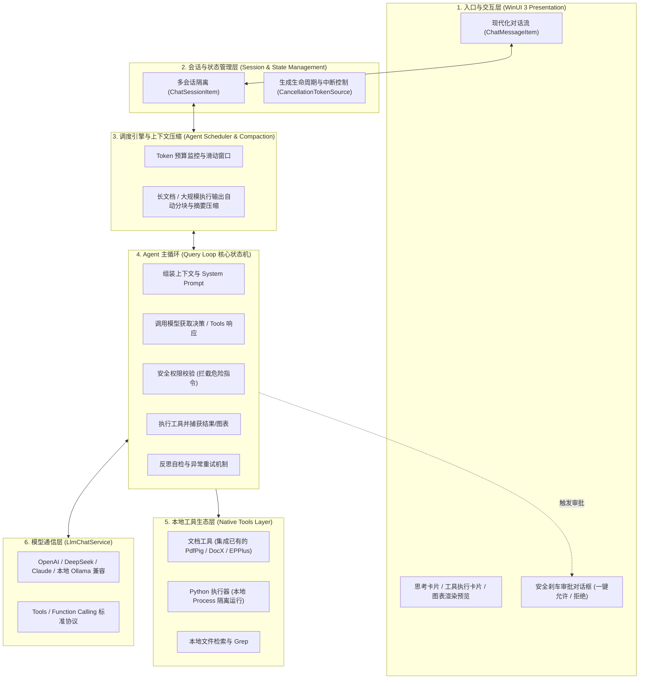

# DataAnalysis_Assistant 架构设计与分阶段实施规划

> **核心定位**：基于 WinUI 3 + .NET 8 构建的本地 Agentic 数据分析与业务文档智能研报助手，融合 **CodeAct (Code-as-Action)** 与 **Agentic Harness** 编排体系，支持跨文档深度总结、本地安全代码执行、动态图表渲染与自检反思闭环。

---

## 一、 核心架构设计：Agentic Harness 6层系统

本项目不局限于单一的提示词对话，而是构建一套运行在 Windows 客户端的本地 **Agent Runtime（智能体运行时引擎）**，分为 6 个层级：



---

## 二、 联合数据分析典型工作流

以“**分析业务销售 CSV 并结合业务规范 PDF 输出研报**”为例：

```
[用户提问]："分析本季度销售 csv，结合业务规范 PDF 中的口径，指出异常指标并画出趋势图"
   │
   ▼
[Step 1 任务规划] Agent 自主将任务拆解为子目标：
   ├─ 子任务 1：调用 DocumentTool 读取业务规范 PDF，提取考核标准与毛利计算口径；
   ├─ 子任务 2：调用 PythonTool 执行探查代码 (df.head(), df.info()) 获取 CSV 字段结构；
   ├─ 子任务 3：调用 PythonTool 运行清洗代码，根据业务口径筛选出异常数据；
   ├─ 子任务 4：调用 PythonTool 生成可视化趋势图 (Matplotlib)，导出至 scratch 目录；
   └─ 子任务 5：汇总业务口径、数据计算结果与图表，输出最终综合研报。
   │
   ▼
[Step 2 工具调用循环与自检]：
   ├─ 模型产生 tool_calls -> 本地执行 -> 结果截断保护后回传给模型；
   ├─ 若 Python 运行报错 (如 KeyError)，Agent 捕获异常，自行动态修改代码并重试；
   └─ 完成数据提取后，Agent 自动对比结论是否与原始数据矛盾。
   │
   ▼
[Step 3 终止与交付]：
   在 WinUI 3 界面输出 Markdown 结构化报告，就地内嵌渲染趋势图，并将生成的分析代码折叠展示供用户复查。
```

---

## 三、 分阶段实施路线图 (Phase-by-Phase Roadmap)

为了保证系统迭代的稳健与高代码质量，项目实施划分为 **五个关键演进阶段**：

### 阶段一：模型通信层与 Tools 协议标准化 (基础底座) [已完成] ✅

- **目标**：让现有 `LlmChatService` 具备标准的 Function Calling / Tools 交互能力，兼容主流模型。
- **实施内容**：
  1. **数据模型扩展**：
     - 定义 `ToolDefinition`（包含函数名称、描述、JSON Schema 参数定义）；
     - 定义 `ToolCallItem` 与 `ToolCallResult`，支持流式与非流式返回中的工具调用解析。
  2. **请求参数升级**：
     - 在请求体中增加 `tools` 与 `tool_choice` 参数；
     - 统一支持 OpenAI 兼容格式以及 DeepSeek Function Calling 规范。
  3. **单元与联调验证**：
     - 编写最小验证用例，验证模型能准确识别用户意图并触发预设的虚拟工具。
- **阶段交付物**：
  - `Models/AgentToolModels.cs`：标准工具定义、调用项与执行结果模型；
  - `Services/Tools/IAgentTool.cs`：Agent 原生工具抽象接口；
  - `Services/LlmChatService.cs`：新增 `SendChatWithToolsAsync` 与流式 `StreamChatCompletionWithToolsAsync`，支持 `reasoning_content` 与 `tool_calls` 双流解耦。

---

### 阶段二：本地 Python 执行引擎与安全刹车机制 (CodeAct 引擎) [已完成] ✅

- **目标**：安全、稳定地在本地 Windows 运行 Python 脚本，支持输出捕获与权限审批。
- **实施内容**：
  1. **Python 环境探测与管理**：
     - 实现 `PythonEnvironmentService`，检测用户系统的 `python.exe` 路径及 `pandas`、`matplotlib` 等依赖包安装状态；
     - 提供缺失依赖的一键提示与指引。
  2. **受控执行器 (PythonExecutionService)**：
     - 基于 `System.Diagnostics.Process` 异步执行生成的 Python 脚本；
     - 严格设置**超时控制**（默认 30 秒，防止死循环耗尽资源）；
     - 捕获 `stdout`、`stderr` 与进程退出码。
  3. **上下文保护截断 (Compaction Gate)**：
     - 限制 stdout 字符串长度（例如最大 4000 字符），超过阈值自动截取前 50 行并附带提请模型精简输出的提示，防止 Token 爆炸。
  4. **安全刹车层 (Safety Approval)**：
     - 在执行前判定代码风险等级：纯数据分析代码 vs 涉及文件修改/系统命令的代码；
     - UI 层提供可确认的安全审批卡片，用户点击“允许”后才拉起本地进程。
- **阶段交付物**：
  - `Models/PythonExecutionModels.cs`：环境状态、代码风险评级与执行选项模型；
  - `Services/Python/SafetyGateService.cs`：基于敏感规则特征扫描的安全刹车与风险阻断引擎；
  - `Services/Python/PythonEnvironmentService.cs`：Windows 本地 Python 与 Pandas/Matplotlib/Numpy 数据科学库诊断服务；
  - `Services/Python/PythonExecutionService.cs`：受控进程执行器，支持强隔离、30秒超时熔断、4KB输出摘要截断与图表产物捕获；
  - `Services/Tools/RunPythonTool.cs`：实现 `IAgentTool` 接口的标准 Agent Python 执行工具；
  - `MainWindow.xaml` / `MainWindow.xaml.cs`：设置页面新增【本地 Python 沙盒与安全执行引擎】面板，提供一键重新诊断、库状态标签与安全模式切换。

---

### 阶段三：可视化分析闭环与图表呈现 (图表与看板联动) [已完成] ✅

- **目标**：模型生成的统计图表能够直接在 WinUI 3 聊天流中高质量渲染预览与保存，并与可视化看板深度联动。
- **实施内容**：
  1. **图像导出与标准协议**：
     - 在 Python 执行器中内置绘图增强预处理：自动配置 `matplotlib.use('Agg')` 防 GUI 阻塞，强制配置 `Microsoft YaHei` / `SimHei` 等中文备用字体库杜绝豆腐块乱码；
     - 自动拦截 `plt.show()`，并在检测到未保存活动图表时自动注入 200 DPI 规范保存代码，集中输出到隔离沙盒目录 `scratch/`。
  2. **UI 消息卡片支持多模态渲染**：
     - 新建 `ChartArtifactItem` 模型，扩展 `ChatMessageItem` 包含 `GeneratedPlots` 集合与卡片视图属性；
     - 在 `MainWindow.xaml` 消息气泡中内嵌高清图表展示卡片，支持放大预览、复制到剪贴板、另存为以及固定推送到看板。
  3. **看板数据沉淀与交互画廊**：
     - 彻底激活中栏【可视化】页面（`gridVisualizationView`），构建动态大屏看板；
     - 配备主图大屏展示、`PlotGallery` 水平缩略图画廊（支持实时高亮选中与主视图联动）；
     - 支持打开缓存图表目录与【一键生成示例分析图表】快速验证全流程。
  4. **全局全屏/居中大图查看器**：
     - 构建轻量半透明模态查看器 `gridPlotImageViewer`，支持随时点击高清全屏查看、复制与导出。
- **阶段交付物**：
  - `Models/ChartArtifactItem.cs`：图表产物数据模型，支持 UI 线程懒加载 BitmapImage、格式化大小与看板状态通知；
  - `Models/ChatMessageItem.cs`：支持多模态图表集合与绑定可见性；
  - `Services/Python/PythonExecutionService.cs`：增强版 Python 代码预处理器，中文无乱码 + Agg 后端 + 自动图表捕获；
  - `MainWindow.xaml` / `MainWindow.xaml.cs`：聊天消息卡片图表多模态渲染器、动态可视化分析看板大屏、水平缩略图画廊与全局全屏大图查看器。

---

### 阶段四：跨文档联合分析与数据保真机制 (Data Integrity & Precision Context) [已完成] ✅

- **目标**：打通本地多格式文档（PDF/Word/Excel/CSV/TXT）与 Python 全量数据计算，**彻底杜绝因粗暴截断上下文而导致的数据残缺与虚假统计**，确保数据 100% 完整与结论客观准确。
- **实施内容**：
  1. **“数据不动代码动”计算下推范式 (Code-to-Data)**：
     - **严禁直接把原始大表明细硬塞入 Prompt**（彻底消除 Token 爆炸与截断失真）；
     - 原始全量数据（即使包含数百万行记录）始终 100% 完整留存于本地磁盘或内存；
     - 引入 `DataSchemaProfiler` 工具：支持 CSV（自动检测 GB18030/UTF-8 编码与分隔符）及 Excel (.xlsx/.xls)，极速生成包含总行列数、字段名、推断类型、缺失率、极值分布、均值与前 5 行样例（Head preview）的高密度骨架视图；
     - 指导模型根据骨架编写精准的 Pandas/Numpy 聚合分析代码在本地全量运行。
  2. **非结构化文档的“目录索引 + 无损段落提取” (Precision Chunking)**：
     - 封装 `DocumentReaderTool`，直接复用当前项目中已完成的 `DocX`、`PdfPig`、`EPPlus` 解析管道；
     - 采用两阶段精准调取：模型先调取文档目录/大纲定位章节（如“考核口径与返点规则”），再原文字节级提取该章节的**完整原始内容（零截断、零压缩）**，确保业务规则理解一字不差。
  3. **严格界定上下文压缩边界 (Compaction Boundary Guard)**：
     - **可压缩区**：仅压缩多轮探索中被淘汰的代码尝试、多余的临时日志输出及冗长对话历史；
     - **绝对常驻区 (严禁压缩)**：全量代码执行产生的**最终高密度事实统计表（Ground-Truth Metrics）**、数据表 Schema 与**业务文档原始关键条款**，作为硬性事实锚点永久保留在上下文窗口中，并附加保真度验证徽标。
- **阶段交付物**：
  - `Models/DataSchemaModels.cs`：字段级元数据模型与高质量 Markdown/Prompt 骨架导出器；
  - `Services/Data/DataSchemaProfiler.cs`：高性能大表结构探查器，支持中文 Windows 编码自动嗅探与极速采样；
  - `Services/Tools/DocumentReaderTool.cs`：大纲索引定位、原文字节级无损提取与全文高精度检索原生 Agent 工具；
  - `Services/Context/ContextCompactionService.cs`：带硬性事实保护边界的上下文压缩引擎；
  - `Models/DocumentItem.cs`：扩展表格检测属性 `IsTabularData`、`SchemaProfile` 与 `TableSummary`；
  - `Services/LlmChatService.cs`：统一接入 Code-to-Data 系统原则与保真上下文组装；
  - `MainWindow.xaml.cs`：表格导入自动生成骨架视图、跨文档关联索引自动感知。

---

### 阶段五：自主反思、多步 Agent 循环与综合研报导出 (终极闭环) [已完成] ✅

- **目标**：实现完整的 ReAct / CodeAct 自主主循环，具备错误自愈重试、结论交叉验证与专业研报一键导出。
- **实施内容**：
  1. **Agent 核心状态机 (AgentQueryLoop)**：
     - 循环运行机制：`思考 -> 决策工具 -> 执行工具 -> 评估结果 -> 自主反思自愈 -> 终止交付`；
     - 设置单次任务的最大循环轮次（上限 8 轮），防止无限递归；
     - 深度支持已有就地【停止】操作，用户可随时打断 Agent 的连续推导与工具执行。
  2. **自动反思与容错重试 (Self-Reflection & Healing)**：
     - 当 Python 报错或文档未找到对应字段时，Agent 自动将 Traceback 与异常输出回填至历史回合，自我调整代码逻辑再次尝试（设置 3 次连续报错硬性熔断刹车）。
  3. **研报专业级导出 (Word .docx & Markdown .md)**：
     - 基于 `Xceed.Words.NET` 实现专业 Word 研报排版导出（大标题、元数据横幅、Markdown 多级标题转换、原生表格排版、代码高亮框、内嵌高清图表与居中图题）；
     - 支持标准 Markdown 研报导出（包含 Frontmatter 元数据与图表引用）；
     - 在消息气泡卡片操作栏与可视化看板顶栏/底栏增加【📄 导出研报】与【📋 复制回答】按钮，支持通过系统保存选择器一键导出并自动定位目录。
- **阶段交付物**：
  - `Services/Agent/AgentQueryLoopService.cs`：自主 ReAct / CodeAct 状态机调度引擎，支持多轮推导、工具执行、思考流记录与进度实时上报；
  - `Services/Export/ReportExportService.cs`：格式精美的专业 Word (.docx) 与 Markdown (.md) 综合研报导出器；
  - `MainWindow.xaml` / `MainWindow.xaml.cs`：消息气泡卡片与大屏看板双入口研报导出事件、Agent 主循环驱动、实时进度呈现与图表资产沉淀。

---

## 四、 核心接口设计草案

```csharp
// 1. 工具抽象接口
public interface IAgentTool
{
    string Name { get; }
    string Description { get; }
    string ParametersJsonSchema { get; }
    bool RequiresUserApproval { get; }
    Task<ToolExecutionResult> ExecuteAsync(string argumentsJson, CancellationToken cancellationToken);
}

// 2. 执行结果
public class ToolExecutionResult
{
    public bool Success { get; set; }
    public string Output { get; set; } = string.Empty;
    public string? ErrorMessage { get; set; }
    public List<string> GeneratedArtifacts { get; set; } = new(); // 产出图片或文件路径
}

// 3. 数据探测与保真视图 (Schema Profile)
public class DataProfileResult
{
    public string TableName { get; set; } = string.Empty;
    public long TotalRowCount { get; set; }
    public int ColumnCount { get; set; }
    public List<ColumnMeta> Columns { get; set; } = new();
    public string SampleRowsMarkdown { get; set; } = string.Empty; // 仅含前 3 行样例
}

// 4. Agent 运行调度器
public interface IAgentRuntime
{
    Task ExecuteTaskAsync(
        string userPrompt,
        IEnumerable<IAgentTool> availableTools,
        Action<AgentStepUpdate> onStepProgress,
        CancellationToken cancellationToken);
}
```

---

## 五、 防御性规范与安全原则

1. **工作区隔离防污染纪律**：
   - Agent 运行过程中产生的所有临时分析代码、缓存数据、中间测试图像，**强制收容于 `scratch/` 专属临时目录**，严禁污染工程根目录。
2. **代码执行安全沙箱准则**：
   - 默认禁止执行高危系统级命令（如删库、格式化、修改注册表等）；
   - 对非白名单库调用强制要求用户交互式审批确认。
3. **Token 与成本保护准则**：
   - 任何工具输出超过设定阈值（4KB）必须自动截断；
   - 任务最大循环次数硬限制（Max Loops <= 8），防止死循环扣费。

---

## 六、 核心保障：数据完整性与零幻觉策略 (Data Integrity & Zero-Loss Strategy)

在数据分析与长篇研报生成场景中，**上下文压缩或粗暴截断极其容易诱发“数据盲人”与“严重幻觉”**（例如将万行数据截为前50行，导致总和、极值、排名结论全盘失实）。为此，本项目确立以下五条铁律以确保数据 100% 完整与结果绝对真实：

### 1. 计算下推准则：Code-to-Data（数据不动代码动）
```
  ❌ 错误做法：[10万行 CSV] ──截断前50行──> [Prompt/Context] ──> 模型靠幻觉口算 (结果必然错误)
  
  ✅ 本地范式：[10万行 CSV] 始终完整留存在本地硬盘 / 内存
                    ▲
                    │ (Python 本地全量执行: df['amount'].sum() / groupby)
                    │
              [AI 生成精确代码] ──> [本地引擎跑全量] ──> 仅回传高密度计算真值表 ──> [研报结论]
```
- **核心逻辑**：原始大数据**绝不作为明细文本硬塞给大模型**，大模型只扮演“编写分析代码的工程师”，Python 在本地对全量数据执行 100% 精确的浮点数运算。

### 2. 元数据优先探查：Schema-First 机制
在让模型编写数据清洗与分析代码前，先由 `DataSchemaProfiler` 工具为模型提供一份极低 Token 消耗但结构完整的**数据骨架报告**：
- **行数与列数**：`df.shape`（例如 `125,800 rows × 18 columns`，让模型清晰知晓全量规模）；
- **字段类型与缺失率**：各列 `dtype`、`null_count`、`null_ratio`；
- **数值与分布特征**：数值列的 `min`、`max`、`median`，分类型列的 `unique_count` 与主要类别枚举；
- **小样本样例**：仅提供 3 行样例数据，帮助模型理解日期格式、金额单位与编码规则。

### 3. 非结构化文档高保真按需检索 (Precision Chunking)
对于 PDF、Word 业务规章制度：
- **大纲导航**：先解析文档的目录树或分级标题，让大模型在宏观上理解全书架构；
- **原文无损投喂**：当模型决定研读“第四章第三节：考核扣除项口径”时，工具层调取该段落的**完整原文逐字返回**（禁止对规则文本进行二手 AI 摘要或截断），确保大模型对业务口径的领会与法务/财务原文严丝合缝。

### 4. 严格界定上下文压缩安全边界 (Safe Compaction Boundary)
系统在触发上下文滑动窗口压缩时，执行严格的**分类留存策略**：
- **允许压缩与淘汰**：
  - 中间探索过程的调试性代码与被推翻的错误尝试；
  - 冗长的非关键交互问候与中间思考心路；
  - 临时探查时打印的普通提示信息。
- **严禁压缩（永久锚定在上下文）**：
  - **业务规则原文与口径条款**；
  - **Python 执行得到的全量聚合事实表与核心指标**（Ground-Truth Metrics）；
  - **当前任务的原始需求与最终约束**。

### 5. 确定性断言与证据链闭环 (Deterministic Assertion & Code Audit)
- **代码可溯源**：研报中的每一个关键结论（如“本季度销售总额为 3,842.1 万元，环比下降 4.2%”），必须由系统自动关联到产出该数字的 Python 变量名或执行结果行。
- **自动一致性核验**：在研报输出前，调度引擎执行自检比对：提取正文中提及的数值，与 Python stdout 中的计算真值进行正则匹配比对，若发现不一致立刻拦截并警示，杜绝任何数据幻觉。

