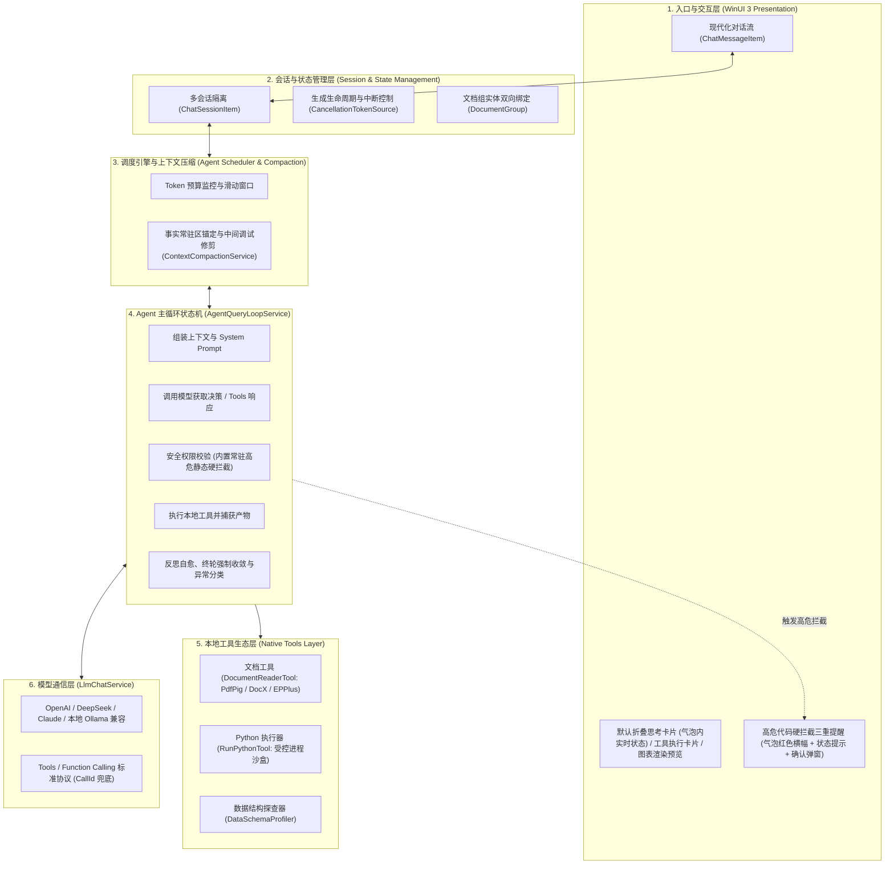
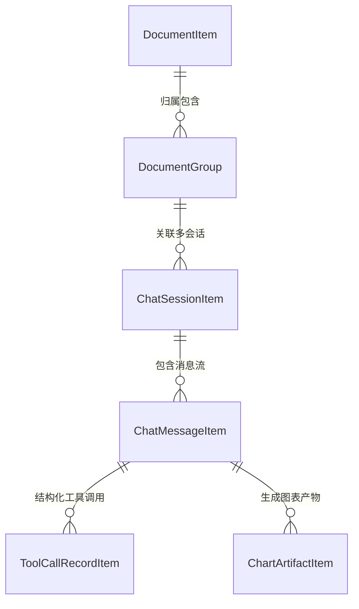

# Data Analysis Assistant AI 对话与 Tools 执行架构设计规范

> **架构定位**：基于 WinUI 3 + .NET 8 构建的桌面端 Agentic 数据分析运行时引擎（Agent Runtime），深度融合 **CodeAct (Code-as-Action)** 与 **Agentic Harness** 编排体系，支持跨文档深度推演、本地安全代码执行、动态图表渲染与自检反思闭环。

---

## 一、 Agentic Harness 6层分层系统架构

系统摒弃单一的静态 Prompt 交互模式，构建了一套高可靠、带反思自检的客户端智能体调度底座：



---

## 二、 核心保障：数据完整性与零幻觉策略 (Code-to-Data)

在数据分析场景下，粗暴截断上下文极易诱发严重的“数据盲人”与“虚假统计”（如将十万行数据截为前50行，导致求和、均值全盘失实）。系统确立以下五条铁律：

### 1. 计算下推铁律：Code-to-Data（数据不动代码动）
```
  ❌ 错误做法：[10万行 CSV] ──截断前50行──> [Prompt/Context] ──> 模型口算 (结果必然失实)
  
  ✅ 本地范式：[10万行 CSV] 始终 100% 完整留存在本地硬盘 / 内存
                    ▲
                    │ (Python 本地全量执行: df['amount'].sum() / groupby)
                    │
              [AI 生成精确代码] ──> [本地引擎跑全量] ──> 仅回传高密度计算真值表 ──> [研报结论]
```
原始大数据明细**严禁作为文本硬塞入 Prompt**，大模型只扮演编写代码的工程师角色，由本地 Python 进程对全量数据执行 100% 精确的浮点运算。

### 2. 元数据优先探查：Schema-First 机制
在让模型编写数据清洗代码前，先由 `DataSchemaProfiler` 工具为模型提供极低 Token 消耗但结构完整的数据骨架：
- **行数与列数**：`df.shape`（让模型感知真实全量规模）；
- **字段类型与缺失率**：各列 `dtype`、`null_count`、`null_ratio`；
- **数值与分布特征**：数值列 `min`、`max`、`median`，分类型列 `unique_count` 与主要类别枚举；
- **小样本样例**：仅提供 3 行样例数据，帮助模型理解日期格式与字段格式。

### 3. 非结构化文档高保真按需检索 (Precision Chunking)
对于 PDF、Word 业务规章制度：
- **大纲导航**：先解析文档的目录树或分级标题，宏观理解全书架构；
- **原文无损投喂**：当模型决定研读特定章节（如“考核扣除项口径”）时，按需逐字提取该段落的**完整原文逐字返回**（禁止二手摘要），确保模型对业务口径理解严丝合缝。

### 4. 上下文压缩安全边界 (Safe Compaction Boundary)
- **允许压缩与淘汰**：中间探索过程中的调试代码、被淘汰的报错尝试、冗长交互问候；
- **严禁压缩（永久锚定）**：业务规则原文条款、Python 执行得到的全量聚合事实表（Ground-Truth Metrics）、当前任务的原始需求与约束。

### 5. 确定性断言与证据链闭环
- **代码可溯源**：研报中的关键结论必须关联到产出该数字的 Python 变量名或执行结果行；
- **自动一致性核验**：调度引擎提取研报提及的数值，与 Python stdout 中的计算真值进行正则匹配比对，发现矛盾即刻警示。

---

## 三、 基于「文件实体为中心」的本地持久化架构

打破传统产品“以会话为唯一主体”的模型，采用**【文档组 + 会话】双绑定模型**：



### 1. 存储目录拓扑规范 (`%AppData%\DataAnalysis_Assistant\`)
```
%AppData%\DataAnalysis_Assistant\
├─ settings.json                    # 全局配置 (API Key, 超时, 模型列表, 图表主题)
├─ skills/                          # 专属用户受控技能目录 (SKILL.md)
├─ cache/
│  └─ schema_profiles/              # 表结构探查缓存 ({DocId}.json)
└─ document_groups/                 # 核心文档组根目录（按组物理自治隔离）
   ├─ group_standalone/             # 独立自由会话专区
   │  ├─ group.json
   │  ├─ documents/
   │  ├─ sessions/
   │  └─ scratch/
   └─ {GroupId}/                    # 对话组自治物理容器 (随机唯一编号)
      ├── group.json                # 对话组核心元数据
      ├── documents/                # 本组专属文档元数据 (doc_meta_{DocId}.json)
      ├── sessions/                 # 本组专属历史会话 (session_{SessionId}.json)
      └── scratch/                  # 本组专属运行沙盒与图表沉淀
          └─ agent_sandbox/         # 本组专属图表产物镜像
```
> **物理隔离铁律**：用户的原始大文件**绝不拷贝**进 AppData 目录，仅记录文件绝对路径与解析提取文本缓存，节省磁盘并支持大文件即开即用。

### 2. 核心实体模型定义
- **DocumentGroup**：`GroupId`、`GroupName`、`DocumentIds` 列表、`CreatedAt`、`LastActiveAt`；
- **DocumentItem**：`DocId`、`OriginalFilePath`、`FileName`、`FileSize`、`ExtractedText`、`IsTabularData`、`SchemaProfile`；
- **ChatSessionItem**：`SessionId`、`BindGroupId`（可选外键，null 表示独立会话）、`Messages` 列表。

### 3. 持久化服务 `LibraryPersistenceService`
- 提供文档、文档组与会话的异步并发安全 CRUD（配备 `SemaphoreSlim` 异步锁）；
- 启动自动校验源文件物理存在性，优雅标记丢失状态，杜绝闪退；
- 增量无感存盘：每轮 Agent 工具调用结束或 LLM 输出完毕时异步触发写盘，防崩溃丢失。

---

## 四、 本地工具生态与产物捕获闭环

### 1. 核心工具矩阵
| 工具名称 | 接口定义 | 核心职责 |
| :--- | :--- | :--- |
| `run_python` | `RunPythonTool` | 在本地独立子进程执行 Python 数据分析代码，捕获 stdout/stderr 与图表 |
| `read_document` | `DocumentReaderTool` | 针对当前挂载的文档集合，按大纲定位、关键词搜索或原文字节提取内容 |
| `profile_table` | `DataSchemaProfiler` | 针对大表极速生成元数据、字段类型、极值与前 5 行样例的高密度骨架 |

### 2. 增强型 Matplotlib 双向全接口 Monkey-Patch
为了兼容学术界常见的面向对象绘图代码（`fig, ax = plt.subplots(); fig.savefig(...)`），垫片同时拦截 `plt.savefig` 与 `Figure.savefig`：

```python
# === [DataAnalysis_Assistant Universal Plot Interceptor] ===
try:
    import matplotlib
    import matplotlib.pyplot as plt
    import os, shutil, uuid, time, sys

    _target_scratch = r'{safePlotDir}'
    os.makedirs(_target_scratch, exist_ok=True)
    _orig_plt_savefig = plt.savefig
    _orig_fig_savefig = matplotlib.figure.Figure.savefig

    def _safe_intercept(fname, *args, **kwargs):
        # 1. 执行原始保存
        # 2. 唯一防覆盖重命名：原名_时间戳_短UUID.ext
        raw_name = os.path.basename(str(fname))
        stem, ext = os.path.splitext(raw_name)
        unique_name = f"{stem}_{int(time.time())}_{uuid.uuid4().hex[:6]}{ext}"
        mirror_path = os.path.join(_target_scratch, unique_name)
        
        # 3. 强制镜像拷贝至沙盒目录并打印标记
        if os.path.exists(str(fname)):
            shutil.copy2(str(fname), mirror_path)
            print(f"[ARTIFACT_CAPTURED]: {mirror_path}")

    plt.savefig = lambda fname, *a, **kw: (_orig_plt_savefig(fname, *a, **kw), _safe_intercept(fname, *a, **kw))[0]
    matplotlib.figure.Figure.savefig = lambda self, fname, *a, **kw: (_orig_fig_savefig(self, fname, *a, **kw), _safe_intercept(fname, *a, **kw))[0]
except Exception as e:
    sys.stderr.write(f"[INTERCEPT_INIT_ERR]: {str(e)}\n")
```

### 3. 动态遗留资产扫描与兜底回收
Python 脚本执行完毕后，系统对 `scratch/` 根目录执行增量比对：若发现未被 Hook 拦截到的遗留图片或表格，自动搬运至 `agent_sandbox/` 并完成命名标准化，保证产物 100% 捕获至右侧画廊与消息卡片。

---

## 五、 专属受控用户 Skill 扩展与 Slash Command 深度注入

### 1. 专属受控存储
- 废除扫描系统全局跨工具目录的传统做法，彻底收敛锁定至专属目录：`%APPDATA%\DataAnalysis_Assistant\skills`；
- 用户通过界面一键导入包含 `SKILL.md` 的外部文件夹，系统自动完成合法性校验并复制到专属目录。

### 2. 对话框 Slash Command (`/`) 浮层交互
- 输入框键入 `/` 触发上拉面板，展示已安装技能列表；
- 支持实时模糊过滤，方向键上下导航，回车/Tab 键确认选中；
- 选中后擦除 `/`，生成 `[ </> 技能名 ✕ ]` 胶囊卡片（Pill），光标无缝继续输入业务提问。

### 3. 提示词深度注入与沙盒边界隔离
- 发送任务时，异步提取该 Skill 目录下的 `SKILL.md` 全文规约；
- **受控沙盒边界红线警告**：在注入时强行追加安全声明：
  > “【⚠️ 系统受控沙盒环境边界约束】：
  > 当前任务运行在本地专属数据沙盒中。技能指南中引用的内部配置文件与脚本（如 manifest.yaml、static/* 等）属于技能系统元架构，在当前执行环境中**物理不可达**。
  > 严禁调用 `read_document` 或编写 Python 代码尝试搜索这些技能内部文件！请直接基于技能指南中的绘图哲学、配色规范与排版原则进行分析。”
- 彻底消除模型因机械执行指南而陷入沙盒死循环空耗迭代的严重缺陷。

---

## 六、 状态机调度、收敛与全链路故障治理规范

### 1. 取消令牌 (CancellationToken) 绝对最高优先级
一旦检测到用户点击【停止】（`cancellationToken.IsCancellationRequested == true`），系统**立即跳出主循环，坚决不再发起任何大模型请求**，直接标记 `TerminationReason = UserCancelled`，零额外 Token 消耗。

### 2. 终轮双状态强制收敛机制
- 当轮次达到上限（`MaxIterations` 默认 12 轮，UI 开放 `[6, 20]`）：
  - **协议层**：发送请求时设置 `tool_choice = "none"` 并清空工具列表；
  - **代码层丢弃防御**：针对部分本地或开源模型忽略参数强行输出 `tool_calls` 的行为，代码层增加硬性拦截：**直接丢弃其 tool_calls**，仅提取纯文本并触发最终总结；
  - 避免到达轮次上限时直接硬中断，确保必须输出综合研报。

### 3. 执行分级超时与 heavy_work 机制
- 默认执行超时放宽至 `60 秒`（UI 开放 `[30s, 120s]`），且具备 `Math.Max(60, ...)` 兼容保底；
- `RunPythonTool` 提供可选参数 `heavy_work: boolean`，模型处理超大规模数据时显式声明申请放宽超时上限。

### 4. 时序竞态与写盘状态完全消除
- 在后台 Task 线程完成 `RunLoopAsync` 后，**先直接同步为实体赋值**：
  ```csharp
  assistantMessage.ThinkingSeconds = totalThinkingTime;
  assistantMessage.TerminationReason = loopResult.TerminationReason;
  assistantMessage.ToolCalls = new List<ToolCallRecordItem>(loopResult.ExecutedToolCalls);
  ```
- 再通过 `DispatcherQueue.TryEnqueue` 投递纯 UI 视觉变更；
- 最后进入 `finally` 执行持久化写盘，彻底根除“写盘抢跑导致数据库中状态持久化为 0 或空”的恶性 Bug。

### 5. 协议链路 CallId 补齐与多轮追问历史重建
- 解析流式响应时，若网关未下发 `id`，客户端自动兜底补齐 `call_{Guid.NewGuid():N}`；
- 多轮追问收集历史消息时，利用 `msg.ToolCalls` 完整重建标准的 `assistant(tool_calls)` 与 `tool(content)` 协议回合，保证大模型追问时对前情工具推演了如指掌。

### 6. 防重复重绘与正文裂图根治
- 工具执行成功回填时，注入系统标记：`[ARTIFACT_CONFIRMED]: 图表已由系统前端画廊安全接管，严禁以微调为由重复重绘，请直接撰写研报。`
- 严禁在 Markdown 正文中输出形如 `` 的相对路径图片语法，彻底消除前端因相对路径寻址失败导致的裂图。
