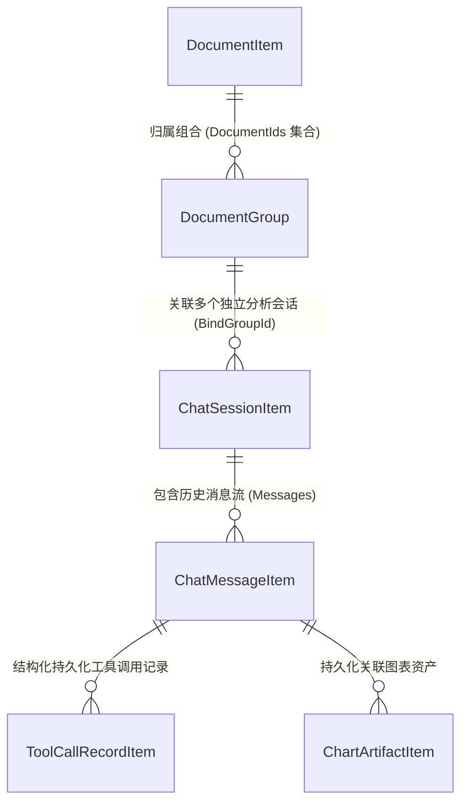
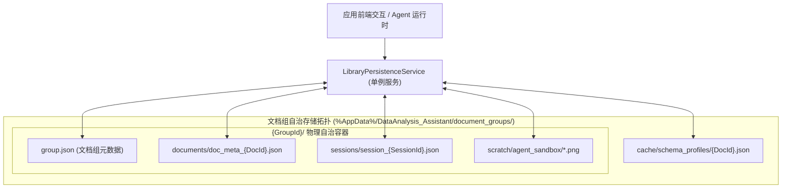

# Data Analysis Assistant 文档组与对话记忆管理设计与实施规约

> **核心定位**：基于「文件实体为中心」的本地持久化会话与文档库存储管理体系，打破传统聊天产品将会话作为唯一根实体的局限，构建**【文档组 + 会话】双绑定模型**，实现多文档资产聚合、重启软件上下文秒级恢复、多轮 CodeAct 推演增量存盘与全自动闭环交互。

---

## 一、 设计理念与模式架构

### 1. 痛点分析与传统模式缺陷
- **传统聊天产品模式**：`会话 (ChatSession) ➔ 消息列表 (Messages) ➔ 附件 (Attachments)`。在该模式下，文件仅作为某次会话的从属附件存在，当用户在不同会话中针对同一组业务数据进行多方向分析时，会导致文档重复上传、文本重复解析、表结构重复探查，且无法跨会话进行文档资产管理。
- **数据分析 Agent 业务场景特点**：用户通常以固定的一组关联文件（如 `2025Q3销售.csv + 考核口径.pdf`）为基础，发起多轮独立分析（如会话 A 专攻“异常数据核查”，会话 B 专攻“增长趋势预测与研报输出”）。

### 2. 双绑定模型架构
系统以**文档库（Document Library）**为基石，采用【文档组 + 会话】双向绑定机制：



- **双模式共存**：
  1. **绑定文档组会话模式 (`BindGroupId != null`)**：会话强绑定一组 `DocumentItem`，打开该会话时系统自动挂载该组全部文件至 Agent 运行时；打开文档组时，系统自动检索其关联的所有历史会话。
  2. **独立自由会话模式 (`BindGroupId == null`)**：兼容无需任何文件支撑的纯自由对话与算法探讨。

---

## 二、 本地存储目录拓扑规范

系统完全兼容 Unpackaged WinUI 3 架构，所有本地数据收容于 Windows 标准用户目录 `%AppData%\DataAnalysis_Assistant\`，与 `SettingsService` 保持存储根节点一致：

```
%AppData%\DataAnalysis_Assistant\
├─ settings.json                    # 原有全局配置 (API端点、Key、模型、超时等)
├─ skills/                           # 专属用户受控技能目录 (SKILL.md)
├─ cache/
│  └─ schema_profiles/               # 表结构探查缓存 ({DocId}.json)
└─ document_groups/                  # 核心文档组根目录
   ├─ group_standalone/              # 独立自由会话专区
   │  ├─ group.json
   │  ├─ documents/
   │  ├─ sessions/
   │  └─ scratch/
   └─ {GroupId}/                     # 对话组自治物理容器 (随机唯一编号)
      ├── group.json                 # 对话组核心元数据
      ├── documents/                 # 本组专属文档元数据 (doc_meta_{DocId}.json)
      ├── sessions/                  # 本组专属历史会话 (session_{SessionId}.json)
      └── scratch/                   # 本组专属代码运行沙盒与图表沉淀
          └─ agent_sandbox/          # 本组专属图表产物镜像
```

> **物理文件隔离铁律**：用户的原始大文件（如数百兆的大型 CSV/Excel）**绝不拷贝进 AppData 目录**，磁盘仅保存文件的原始绝对路径！若用户在外部移动或删除了文件，UI 自动标记“文件缺失”警告，保留本地缓存的文本与 Schema 骨架，并支持用户重新定位文件。

---

## 三、 实体模型扩展与数据契约

### 1. DocumentGroup（文档组，核心聚合实体）
```csharp
public class DocumentGroup : INotifyPropertyChanged
{
    public string GroupId { get; set; } = Guid.NewGuid().ToString("N");
    public string GroupName { get; set; } = string.Empty; // 如：sales 等2个文件、Q3销售与口径
    public List<string> DocumentIds { get; set; } = new(); // 关联的 DocId 清单
    public DateTime CreatedAt { get; set; } = DateTime.Now;
    public DateTime LastActiveAt { get; set; } = DateTime.Now;
    
    // UI 扩展属性 (不参与持久化)
    [JsonIgnore]
    public bool IsSelected { get; set; }
    [JsonIgnore]
    public int DocumentCount => DocumentIds?.Count ?? 0;
}
```

### 2. DocumentItem（文档元数据实体）
```csharp
public class DocumentItem : INotifyPropertyChanged
{
    public string DocId { get; set; } = Guid.NewGuid().ToString("N");
    public string OriginalFilePath { get; set; } = string.Empty; // 原始文件绝对路径
    public string FileName { get; set; } = string.Empty;
    public long FileSize { get; set; }
    public string FileType { get; set; } = string.Empty; // .csv, .xlsx, .pdf, .docx
    public string ExtractedText { get; set; } = string.Empty; // 缓存提取的无损纯文本
    public int TokenEstimate { get; set; }
    public bool IsTabularData { get; set; } // 是否为表格
    public string? TableSummary { get; set; } // 高密度 Markdown 结构骨架
    public DataProfileResult? SchemaProfile { get; set; } // 完整探查元数据
    public DateTime RegisteredAt { get; set; } = DateTime.Now;
    
    // 物理状态探查属性
    [JsonIgnore]
    public bool IsFileExisting => !string.IsNullOrEmpty(OriginalFilePath) && File.Exists(OriginalFilePath);
}
```

### 3. ChatSessionItem（会话实体）
```csharp
public class ChatSessionItem : INotifyPropertyChanged
{
    public string SessionId { get; set; } = Guid.NewGuid().ToString("N");
    public string? BindGroupId { get; set; } // 👉 可选绑定到 DocumentGroup；null 代表独立会话
    public string BindGroupName { get; set; } = string.Empty;
    public string Title { get; set; } = "新会话";
    public DateTime CreatedAt { get; set; } = DateTime.Now;
    public DateTime LastActiveAt { get; set; } = DateTime.Now;
    public List<ChatMessageItem> Messages { get; set; } = new();
}
```

---

## 四、 核心服务层设计：`LibraryPersistenceService`

`LibraryPersistenceService` 作为独立的单例服务，专门管理文档库、文档组与会话持久化的生命周期：



### 核心 API 定义
```csharp
public interface ILibraryPersistenceService
{
    // 文档元数据 CRUD 与缓存
    Task<DocumentItem> SaveDocumentMetaAsync(DocumentItem doc);
    Task<DocumentItem?> LoadDocumentMetaAsync(string docId);
    Task<List<DocumentItem>> ListAllDocumentsAsync();
    
    // 文档组 CRUD
    Task<DocumentGroup> CreateDocumentGroupAsync(string groupName, IEnumerable<string> docIds);
    Task UpdateDocumentGroupAsync(DocumentGroup group);
    Task DeleteDocumentGroupAsync(string groupId);
    Task<List<DocumentGroup>> ListAllGroupsAsync();
    
    // 会话与关联映射
    Task SaveSessionAsync(ChatSessionItem session);
    Task<ChatSessionItem?> LoadSessionAsync(string sessionId);
    Task<List<ChatSessionItem>> GetSessionsByGroupIdAsync(string groupId);
    Task<List<ChatSessionItem>> ListAllSessionsAsync();
    Task DeleteSessionAsync(string sessionId);
    
    // 物理状态核验
    bool CheckDocumentFileExists(DocumentItem doc);
}
```

---

## 五、 全业务工作流与交互闭环

### 场景 A：用户导入新文件，自动新建文档组与同名会话（全自动闭环）
1. 用户点击中栏左上角【选择文件】多选导入文件（如 `sales.csv` + `rule.pdf`）；
2. 系统生成唯一 `DocId`，无损提取文本与 Schema 骨架并持久化写入专属 `documents/`；
3. 系统**自动创建新文档组**：
   - 单文件导入：组名默认取去除后缀的文件名（如 `sales`）；
   - 多文件导入：组名默认取 `$"{首文件名} 等{文件总数}个文件"`（如 `sales 等2个文件`）；
4. 系统**自动新建关联会话**：
   - 会话标题（`Title`）与新文档组名称完全一致；
   - 显式绑定 `BindGroupId = GroupId`，`BindGroupName = GroupName`；
5. 工作区自动加载该组文件，中间板块展示首个文档，右侧自动就绪全新提问面板；
6. 全部元数据实时写入本地磁盘，软件关闭后持久化保留。

### 场景 A-2：文档组双击与右键多会话管理
1. **左键双击文档组**：自动切换视图至【工作区文档】视角，完整呈现并高亮该文档组包含的所有文件，供用户直接查验或预览单文件；
2. **右键单击文档组**：弹出上下文菜单，选择【基于此文档组新建对话】，支持同一个文档组建立多个独立会话（例如分别进行“异常数据核查”与“增长趋势预测”）。

### 场景 B：重启软件，继续针对同一组文档的历史对话
1. 启动软件，从本地加载全部文档组列表，左侧抽屉渲染展示；
2. 用户选中文档组，系统自动检索绑定该 `GroupId` 的所有历史会话；
3. 用户点击会话卡片 ➔ 内存秒级复原全部 `ChatMessageItem`，自动将组内文档注入当前工作区与 `AgentQueryLoopService` 上下文；
4. 用户直接接续上一轮任务继续追问，Agent 具备完整的前情工具调用与计算结果记忆。

### 场景 C：普通自由对话（无文件）
- `BindGroupId = null`，会话作为独立会话持久化存储，无需任何文档依赖。

### 场景 D：文档移动/删除保护机制
- 读取 `DocumentItem` 时自动校验 `OriginalFilePath` 物理存在性；
- 若文件被移动或删除，UI 呈现 `⚠️` 警告徽标；
- 本地提取的文本缓存与 Schema 骨架依然可用，问答不受影响；当需要 Python 运行本地代码时，引导用户重新定位物理路径。

---

## 六、 与 Agent Runtime 运行时整合规范

### 1. 加载会话时自动组装 Agent 上下文
当用户激活一个绑定文档组的会话时：
1. 通过 `BindGroupId` 索引该组全部 `DocId`；
2. 批量加载 `DocumentItem`（直接命中本地文本与 Schema 缓存，零耗时加载）；
3. 将文档集合与历史消息一并组装送入 `AgentQueryLoopService`，恢复 Agent 运行状态；
4. `ContextCompactionService` 正常执行滑动窗口压缩，永久锚定 Ground-Truth 核心指标。

### 2. 防卡顿增量写盘机制 (Debounce & Step-Level Persistence)
- 严禁在打字机流式输出的字符回调中频繁读写磁盘；
- **核心存盘触发点**：
  - 用户发送新问题时（立即持久化写入一条新用户消息）；
  - 每次 Tool 执行结束时（持久化工具调用与执行反馈）；
  - Agent 最终结论完成输出或用户点击【停止】中断时（写入完整总结并更新会话活跃时间）；
- 采用后台 Task 异步执行，不阻塞 UI 消息泵。

### 3. 数据表 Schema 探查极速缓存结合
- `DataSchemaProfiler` 探查大表消耗高 IO，探查结果落地持久化至 `cache/schema_profiles/{DocId}.json`；
- 无论用户何时重开大型 CSV/Excel，瞬时加载骨架，不再重复扫描全表。

---

## 七、 异常防御、并发控制与数据自治管理原则 (Architectural Invariants & Zero-Legacy Principle)

系统彻底废除对旧版扁平存储结构的向后兼容分支与过渡补丁，全链路统一严格执行基于**【自治物理容器 + 单向外键不可变约束】**的最新管理逻辑：

### 1. 会话归属绝对不可变铁律 (Session Binding Immutability)
- 会话自创建生效起，其归属属性（`BindGroupId`）即刻固化；
- 在任何后续生命周期中（包括用户在界面自由切换文档组、导入并新建文档组、增量持久化写盘或刷新历史列表），**严禁修改已有会话的 `BindGroupId`**；
- 用户新建文档组时，一律为新组建立专属全新会话，坚决杜绝为了便利将当前自由会话篡改并挂接至新组。

### 2. 自由独立会话自治契约与去伪造化 (Pure Standalone Invariant)
- **纯粹自由对话契约**：对于无需文件支撑的自由对话，其 `BindGroupId` 永久为 `null`（或空字符串）；
- **自治收容归属**：物理磁盘统一落盘至预留的专属自治专区 `%AppData%\DataAnalysis_Assistant\document_groups\group_standalone\sessions\`；
- **坚决根除伪造分组**：严禁在内存或磁盘上伪造 `"default_group"` 或“默认会话组”对独立自由会话进行强行包装；UI 侧边栏通过系统内置只读专区【独立自由对话】统一汇聚呈现所有 `BindGroupId == null` 的会话，该系统专区受防御保护，禁止被重命名或物理删除；
- **孤儿会话安全收敛**：若因极端情况某会话记录的 `BindGroupId` 在物理磁盘上已被删除，系统自动将其安全降级置为 `BindGroupId = null` 并收归至独立自由对话专区，杜绝指针悬空与数据丢失。

### 3. 彻底去兼容化与干净接口契约 (Zero-Legacy Debt)
- **废弃旧目录自动迁移**：彻底移除代码库中针对旧版扁平目录结构（如 `library/`）的历史搬运与备份迁移代码；
- **废弃旧文件命名嗅探**：文档组元数据在组自治目录下唯一且强制采用标准命名 `group.json`，不再向前探测 `group_*.json`；
- **模型实体无冗余**：`DocumentGroup` 实体仅维护关联文档的 `DocumentIds` 列表，绝不在组内冗余持久化 `SessionIds` 列表；文档组与会话的关系完全以会话持有的 `BindGroupId` 及物理目录自治为准，UI 呈现使用 `[JsonIgnore]` 的 `AssociatedSessions` 动态聚合。

### 4. 异步并发锁与损坏隔离防护
- **并发写入锁**：使用 `SemaphoreSlim` 串行化每个会话与文档 JSON 的磁盘 IO，杜绝多任务并发写入引发的 `IOException`；
- **损坏熔断隔离**：反序列化 JSON 遇到空文件或语法损毁时，自动隔离重命名为备份文件（`.bak`），杜绝启动或解析闪退；
- **安全清理边界**：允许用户一键清空 `scratch/` 运行沙盒临时产物；但核心的 `group.json`、文档元数据与会话记录严禁在后台静默删除，必须经由用户主动确认后方可销毁。
