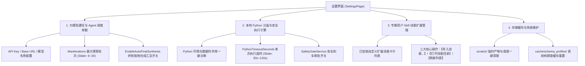

# Data Analysis Assistant 设置界面与偏好配置设计文档

> **设计定位**：为用户提供透明、受控、可诊断且高颜值的偏好设置与系统运行环境控制中心。面板设计严格遵循 Windows 11 Fluent Design 设计语言，采用圆角卡片化分块呈现，保持严谨专业的现代桌面软件质感。

---

## 一、 整体结构与分块概览

设置界面通过二级导航或弹出抽屉展现，整体由三大核心模块与辅助维护工具构成：

---

## 二、 大模型通信与 Agent 调度配置模块

用于配置底层大语言模型的连接参数与推演调度预算。

### 1. 通信端点与模型选择
- **多模型供应商兼容**：原生支持 OpenAI、DeepSeek、Anthropic Claude、Moonshot、通义千问、Ollama 本地大模型等符合 OpenAI 标准接口规范的服务商；
- **配置项输入**：
  - `API 端点地址 (Base URL)`：如 `https://api.deepseek.com/v1`；
  - `API 密钥 (API Key)`：密码框脱敏呈现，支持一键显示/隐藏；
  - `模型标识 (Model Identifier)`：支持自由键入或从常用模型下拉列表中选择（如 `deepseek-chat`、`deepseek-reasoner`、`gpt-4o`、`qwen-plus`）。

### 2. Agent 调度与推演预算
- **Agent 最大自主探索轮次 (MaxIterations)**：
  - 控件：滑动条（Slider），默认设定为 `12` 轮；
  - 调节范围：`[6, 20]` 轮，硬锁上限不超过 20 轮，防止死循环无限消耗费用；
- **自动终轮强制汇总开关 (EnableAutoFinalSynthesis)**：
  - 控件：开关（ToggleSwitch），默认开启；
  - 说明：开启后，当 Agent 执行达到轮次上限时，自动进行终轮不可调用工具的强制收敛回合，生成全量研报；预算敏感型用户可关闭此开关，到达上限后直接轻量截断退出。

---

## 三、 本地 Python 沙盒与安全执行引擎面板

用于控制 CodeAct 本地代码执行的隔离级别、环境完备性与超时熔断保护。

### 1. 环境诊断与依赖包状态检测
- **一键诊断按钮**：提供【重新检测 Python 环境】操作；
- **智能探测逻辑**：
  - 自动在系统 PATH、常见安装路径（如 `C:\Python311`、`C:\Users\<user>\AppData\Local\Programs\Python`、Conda 虚拟环境等）中自动检索有效的 `python.exe`；
  - 探测 Python 主版本信息（要求 >= 3.8）；
- **核心数据科学库状态标签**：
  - `pandas`：数据清洗与表格处理核心（呈现已安装版本号或红色警告徽标）；
  - `matplotlib`：专业科研绘图库（呈现版本号与中文支持状态）；
  - `numpy`：科学计算底层库；
  - `openpyxl`：Excel 读写依赖。
- **一键安装提示**：若检测到核心依赖缺失，在面板底部提供一键复制 `pip install pandas matplotlib numpy openpyxl` 命令的引导卡片。

### 2. 执行安全沙箱与超时熔断
- **单次代码执行超时控制 (PythonTimeoutSeconds)**：
  - 控件：滑动条（Slider），默认基准为 `60 秒`；
  - 调节范围：`[30, 120]` 秒；
  - 底层兼容保底：系统强制施加 `Math.Max(60, settings.PythonTimeoutSeconds)` 保底计算，消除旧版本配置残留 30s 造成的频繁超时报错。
- **安全刹车审批开关 (RequireExecutionApproval)**：
  - 控件：开关（ToggleSwitch），默认根据场景配置；
  - 开启后，凡是涉及系统命令或修改性操作的代码，均强制在 UI 弹出阻断审批对话框，用户点击【允许】后方可拉起本地进程。

---

## 四、 专属用户 Skill 技能扩展管理面板

全面收敛至专属受控目录的高质感自定义技能管理模块。

### 1. 界面布局与视觉规范
- 面板采用与【本地 Python 沙盒】完全统一的卡片容器风格；
- **顶栏统计与三大核心动作**：
  - 状态指示：`已安装扩展技能 (User Skills) X 个技能`；
  - **【导入技能...】按钮**：调用系统文件夹选择器，选择外部包含 `SKILL.md` 的文件夹，系统自动校验合法性并完整复制到专属目录；
  - **【打开技能目录】按钮**：一键在 Windows 资源管理器中打开 `%APPDATA%\DataAnalysis_Assistant\skills` 专属目录，方便高级用户手动管理；
  - **【刷新列表】按钮**：重新遍历目录并刷新内存技能缓存。

### 2. 已安装技能卡片列表
- 列表项清晰呈现已安装技能详情：
  - **技能图标**：`</>` 代码扩展图标；
  - **技能名称**：加粗主标题（如 `nature-figure`、`nature-writing`）；
  - **功能描述**：多行或截断说明文本（如 `Create, revise, audit, and export manuscript scientific figures...`）；
  - **来源路径**：呈现物理子目录名称与就绪状态；
  - **启停开关**：独立的 Toggle 开关，控制该技能在输入框 `/` 快捷指令中的展示与检索可见性。

---

## 五、 存储与系统维护模块

### 1. 临时产物与缓存清理
- **一键清理临时图表产物**：
  - 提供【清空 Scratch 临时图表】按钮；
  - 清理 `%AppData%\DataAnalysis_Assistant\scratch\` 目录下的中间过渡文件与调试图表；
  - 容错保护机制：会话加载时若发现已清理图表，自动呈现“图表已清理”占位卡片，绝不产生未捕获异常或界面崩溃。
- **重置数据表 Schema 探查缓存**：
  - 提供【清空表结构缓存】按钮，清理 `%AppData%\DataAnalysis_Assistant\cache\schema_profiles\`；
  - 用于在数据源被外部修改后，强制下一次导入时重新全量生成 Schema 骨架。

---

## 六、 设置界面交互纪律与设计红线

1. **纯文本无 Emoji 按钮红线**：
   - 设置界面的所有操作按钮（如【重新检测 Python 环境】、【导入技能...】、【打开技能目录】、【刷新列表】、【清空缓存】等），一律采用严谨高质感的**纯文本标签**，严禁掺杂任何装饰性 Emoji。
2. **即时存盘与无损向后兼容**：
   - 设置项的更改（如 Slider 滑动、Toggle 开关切换、文本框失焦）均自动触发 `SettingsService` 写入本地 `settings.json`，无需用户手动点击“保存配置”；
   - 所有配置属性提供安全默认值，旧版或空缺的 `settings.json` 能够平滑补全并反序列化，坚决杜绝因升级配置结构导致软件启动报错。
