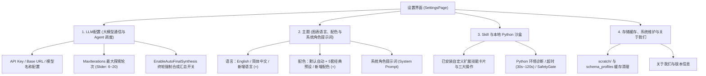

# Data Analysis Assistant 设置界面与偏好配置设计文档

> **设计定位**：为用户提供透明、受控、可诊断且高颜值的偏好设置与系统运行环境控制中心。面板设计严格遵循 Windows 11 Fluent Design 设计语言，采用圆角卡片化分块呈现，保持严谨专业的现代桌面软件质感。

---

## 一、 整体结构与分块概览

设置界面通过左侧功能导航与右侧滚动视图区展现，左侧导航顺序调整为 **`LLM配置` ➔ `主题` ➔ `Skill` ➔ `关于我们`**：

```text
.
├── LLM配置
├── 主题
│   ├── 语言
│   │   ├── English
│   │   ├── 简体中文
│   │   └── 新增语言（显示为一个“+”的框，鼠标放置在上面时显示新增语言）
│   ├── 配色
│   │   ├── 对应主题
│   │   └── 新增配色（显示为一个“+”的框，鼠标放置在上面时显示新增配色）
│   └── 系统角色提示词
├── Skill
└── 关于我们
```



### 设置搜索栏过滤规范 (`tbSettingsSearch`)
- 在保留现有 `LLM配置`、`Skill`、`关于我们` 搜索关键词的基础上，为新增的【主题】导航项补充检索关键词：`主题`、`语言`、`配色`、`提示词`、`prompt`、`颜色`、`theme`、`english`、`中文`；
- 当用户输入关键词过滤导致当前高亮的导航页被隐藏时，自动切换显示首个命中可见的导航视图；清空搜索框时恢复显示全部导航项。

---

## 二、 大模型通信与 Agent 调度配置模块

用于配置底层大语言模型的连接参数与推演调度预算。

> **模块职责调整与迁移说明**：
> - 原位于本页底部的【系统角色提示词 (System Prompt)】已整体迁移至【主题】模块；
> - `LLM配置` 页主标题下方副标题同步调整为“配置大语言模型接口密钥、服务商端点及推理超参数”（移除“及专家人设”）；
> - 本页底部的【恢复默认】与【保存配置】按页独立作用域：`LLM配置` 页恢复默认仅重置连接与推理调度参数（`BaseUrl`、`ModelName`、`MaxContextLength`、`Temperature`、`AgentMaxIterations`、`EnableAutoFinalSynthesis` 等），绝不覆写【主题】板块中选中的语言、配色、自定义列表及系统角色提示词。

### 1. 通信端点与模型选择
- **多模型供应商兼容**：原生支持 OpenAI、DeepSeek、Anthropic Claude、Moonshot、通义千问、Ollama 本地大模型等符合 OpenAI 标准接口规范的服务商；
- **配置项输入**：
  - `API 端点地址 (Base URL)`：如 `https://api.deepseek.com/v1`；
  - `API 密钥 (API Key)`：密码框脱敏呈现，支持一键显示/隐藏；
  - `模型标识 (Model Identifier)`：支持自由键入、从列表下拉选择或点击【获取】拉取当前 API 可用模型列表；拉取结果自动持久化至 `settings.json`（`AvailableModels`）并与主工作区对话输入框旁的模型快捷切换框共享单一数据源。其中【获取】模型列表及对话框旁快捷切换模型即时落盘生效，设置页内手动切换或键入模型后点击页底【保存配置】统一生效并同步。

### 2. Agent 调度与推演预算
- **Agent 最大自主探索轮次 (MaxIterations)**：
  - 控件：滑动条（Slider），默认设定为 `12` 轮；
  - 调节范围：`[6, 20]` 轮，硬锁上限不超过 20 轮，防止死循环无限消耗费用；
- **自动终轮强制汇总开关 (EnableAutoFinalSynthesis)**：
  - 控件：开关（ToggleSwitch），默认开启；
  - 说明：开启后，当 Agent 执行达到轮次上限时，自动进行终轮不可调用工具的强制收敛回合，生成全量研报；预算敏感型用户可关闭此开关，到达上限后直接轻量截断退出。

---

## 三、 主题配置模块（语言、配色与系统角色提示词）

### 1. 模块定位、生效作用域与边界
- **核心原理（纯 Prompt 注入）**：本模块本质上是将用户选中的图表主题偏好与专家人设以结构化提示词形式注入对话上下文（`LlmChatService.BuildMessagesPayload` 组装的 `System Message`），**不改动 `PythonExecutionService` 的 `rcParams` 硬注入逻辑**，保持底层沙盒执行的纯净与模型绘图的灵活性。
- **严格作用域边界（仅约束统计图表）**：
  - 【主题】板块中的「语言」与「配色」**仅作用于 Python（Matplotlib/Seaborn 等）生成的统计图表**，包括图表主副标题、坐标轴名称、刻度标签、图例项、数据标注以及图表的色板与视觉排版风格；
  - **正文对话语言不在此限**：AI 的文字回复、推理阐述与 Markdown 研报正文仍遵循用户当次提问语言及下方【系统角色提示词】约定，杜绝图表语言设置绑架日常问答。
- **实时生效与主界面极简边界**：
  - 配置变更后，每次发送消息时由 `BuildMessagesPayload` 实时读取当前激活配置，**对下一条发送的对话消息立即生效**；
  - 主题配置仅在设置界面【主题】页集中管理，**主工作区右侧 AI 对话栏保持极简**，不新增状态胶囊或快捷切换下拉控件。

### 2. 信息架构与矩形卡片 UI 规范

#### 2.1 页面分块结构
1. **顶部标题与提示栏**：
   - 主标题：`主题`；副标题：`定制统计图表语言、配色方案与分析助手系统角色提示词`；
   - 状态反馈条：`InfoBar`（保存或恢复默认时给予清晰成功/提示反馈）。
2. **分块一：语言（图表标注语言）**：
   - 分组小标题：`语言` + 辅助说明文案（说明仅约束统计图表文字）；
   - 外层卡片容器沿用设置页统一规范（`CardBgBrush` `#FFFFFF`、`CornerRadius="12"`、`BorderBrush="{StaticResource BorderMutedBrush}"`、`Padding="20,16"`）；
   - 内部采用流式网格/自适应换行排布矩形框选项，单选互斥，末尾固定追加 `+` 新增语言矩形框。
3. **分块二：配色（图表视觉配色）**：
   - 分组小标题：`配色` + 辅助说明文案（说明仅约束统计图表色板与风格）；
   - 外层卡片容器与语言区一致，内部采用流式网格排布矩形框选项，单选互斥，末尾固定追加 `+` 新增配色矩形框。
4. **分块三：系统角色提示词 (System Prompt)**：
   - 从原 `LLM配置` 页整体迁入本页底部，保持原有卡片样式与多行文本输入框（`tbSystemPrompt`，`AcceptsReturn="True"`、`TextWrapping="Wrap"`）。
5. **页底操作栏**：
   - 左侧：【恢复默认】按钮（仅独立重置本页默认主题选中态与默认系统角色提示词）；
   - 右侧：【保存配置】按钮（保存当前配置并触发展示 `InfoBar` 成功提示）。

#### 2.2 矩形框选项卡片视觉规范
- **统一色彩语言**：严格遵循现有 WinUI 3 暖纸色系资源（`CardBgBrush` `#FFFFFF`、`CardSubtleBrush` `#FDFCF9`、`SidebarBgBrush` `#EFEAE0`、`BorderMutedBrush` `#E2DDD0`、`AccentWarmBrush` `#B85D19`、`TextPrimaryBrush` `#2E2822`、`TextSecondaryBrush` `#7D746A`）。
- **语言矩形框**：
  - 圆角矩形卡片（如宽 `136~160px`、高 `56px`、`CornerRadius="8"`），内部居中或左对齐展示语言名称；
  - **未选中态**：背景 `CardSubtleBrush` / `CardBgBrush`，1px `BorderMutedBrush` 边框；悬停时边框微亮；
  - **选中态**：`AccentWarmBrush`（`#B85D19`）2px 高亮边框 + 浅暖背景填充，可配纯文本 `当前选中` 角标或加粗主色文字（严禁使用 Emoji）。
- **配色矩形框**：
  - 圆角矩形卡片（如宽 `168~188px`、高 `76px`、`CornerRadius="8"`），采用上下双区布局：
    - **上区（色块预览条）**：横向等分或圆角色块条直观预览该方案的 4~6 个 Hex 色值（对于 `默认自动` 项，展示中性多色阶/虚框自动均衡示意条，与固定色板形成视觉区分）；
    - **下区（主题名称）**：单行截断（`TextTrimming="CharacterEllipsis"`）展示配色主题名称，配合悬浮 `ToolTip` 展示完整名称与 Hex 列表；
  - **选中态**：`AccentWarmBrush`（`#B85D19`）2px 高亮边框与微暖底色。

### 3. 内置预设清单

#### 3.1 内置语言预设（2 项，只读保护）
| ID | 显示名称 | 默认选中 | 图表语言注入语义摘要 |
| :--- | :--- | :--- | :--- |
| `en` | `English` | 否 | 所有统计图表的标题、副标题、坐标轴标签、刻度与图例统一使用专业英文表达 |
| `zh-CN` | `简体中文` | **是** | 所有统计图表的标题、副标题、坐标轴标签、刻度与图例统一使用规范简体中文表达 |

#### 3.2 内置配色预设（6 项，只读保护）
| ID | 显示名称 | 默认选中 | Hex 色板定义 | 视觉风格与排版描述 |
| :--- | :--- | :--- | :--- | :--- |
| `auto` | `默认自动` | **是** | （无固定强制色板） | 默认不强干预，由模型结合数据语义或当前启用的 Skill 自主选用克制专业的配色方案与排版风格 |
| `warm_business` | `暖棕商务` | 否 | `#B85D19, #2E2822, #D49A6A, #6B7B6E, #8C6D46, #C9B8A3` | 呼应本软件暖大地 UI 风格，纯白或浅暖底色、细灰辅助网格、去除顶部与右侧边框脊 |
| `nature_npg` | `Nature 学术 (NPG)` | 否 | `#E64B35, #4DBBD5, #00A087, #3C5488, #F39B7F, #8491B4` | 顶级学术期刊克制规范风，纯白底、清晰刻度线、去除上右轴脊、高分辨率字号层级与精确标注 |
| `mckinsey_blue` | `咨询深蓝 (McKinsey)` | 否 | `#051C2C, #2251FF, #00A9F4, #667B8A, #A2AAAD, #D9A520` | 经典商业咨询研报风，主次深蓝强调核心序列、中性灰弱化次要维度、关键数据标签直出 |
| `morandi_soft` | `莫兰迪柔和` | 否 | `#7A8B99, #A89F91, #B5838D, #84A59D, #D4A373, #9C89B8` | 低饱和度温和汇报配色，多系列对比和谐不刺眼，适合长篇商务报告与PPT配图 |
| `okabe_ito` | `色盲友好 (Okabe-Ito)` | 否 | `#E69F00, #56B4E9, #009E73, #F0E442, #0072B2, #D55E00` | 国际标准无障碍科学调色板，兼顾红绿/蓝黄色觉障碍人群的高可区分度 |

### 4. “+” 框悬停交互与自定义项 CRUD 规范

#### 4.1 “+” 矩形框常态与悬停态
- **常态**：与同区选项矩形框保持等大或协调矩形尺寸，采用虚线/浅灰边框，内部**仅居中显示 `+` 符号**；
- **悬停态 (`PointerEntered` / `PointerOver`)**：边框切换为 `AccentWarmBrush` 高亮态，框内文案平滑切换为纯文本 **`新增语言`**（语言区）或 **`新增配色`**（配色区），并同步绑定 `ToolTipService.ToolTip` 显示对应文字；鼠标移出（`PointerExited`）后恢复 `+`。

#### 4.2 点击弹出 WinUI 3 `ContentDialog` 录入表单
- **新增 / 编辑语言弹窗**：
  1. `语言名称`（必填 `TextBox`）：去除首尾空白后不可为空，不可与内置及已有自定义语言重名；
  2. `图表语言补充提示词`（选填多行 `TextBox`）：允许用户自定义额外指令（如指定数字千分位或单位格式）；若留空，系统按语言名称自动生成规范提示词；
  3. 操作按钮：纯文本【取消】、【保存】。
- **新增 / 编辑配色弹窗**：
  1. `配色名称`（必填 `TextBox`）：去除首尾空白后不可为空，不可与内置及已有自定义配色重名；
  2. `Hex 色板定义`（必填 `TextBox`）：支持逗号、空格或换行分隔输入 **1~8 个**标准 Hex 色值（推荐 4~6 个），逐个匹配正则 `^#(?:[0-9a-fA-F]{3}|[0-9a-fA-F]{6})$`；弹窗内嵌**实时横向色块预览条**，随输入即时渲染色块，存在非法格式或空值时展示内联校验提示并禁用【保存】按钮；
  3. `风格补充描述`（选填多行 `TextBox`）：可填写背景底色、网格线、边框轴脊、字体风格等补充约定；
  4. 操作按钮：纯文本【取消】、【保存】。

#### 4.3 内置只读保护与右键上下文菜单
- **内置预设（只读保护）**：内置语言与内置配色不可直接修改或删除；右键点击时呼出 `MenuFlyout`（纯文本，无 Emoji）：
  - **【查看详情】**：弹出只读 `ContentDialog` 展示完整名称、Hex 色值列表与提示词说明；
  - **【复制为新自定义项】**：以该内置预设为模板预填新增表单（自动附加“副本”后缀防重名），确认后生成用户可自由修改的自定义矩形框。
- **自定义选项（完整 CRUD）**：用户新增的自定义语言/配色矩形框支持右键呼出 `MenuFlyout`（纯文本，无 Emoji）：
  - **【编辑】**：打开对应 `ContentDialog` 回填原有内容，校验通过后更新并即时落盘；
  - **【删除】**：二次确认后移除该自定义项并立即落盘；若被删除项恰好为当前选中项，系统**自动回退至默认项**（语言回退 `简体中文`，配色回退 `默认自动`）。

### 5. Prompt 动态注入机制与优先级裁决

#### 5.1 System Message 拼装顺序
在 `LlmChatService.BuildMessagesPayload` 构造发送给大模型的 `role = "system"` 消息时，按以下顺序拼装：
1. 用户配置/默认的【系统角色提示词 (`settings.SystemPrompt`)】；
2. 【图表主题与视觉规范 (`Chart Theme`)】：根据当前选中的语言与配色实时生成并注入；
3. 若本次对话通过 `/` 启用了用户技能，注入【专属扩展技能 (`activeSkillInstruction`)】；
4. 系统内置【思考与工具推演纪律 (`Reasoning Discipline`)】及【参考文档与数据骨架 (`Code-to-Data`)】。

#### 5.2 四级优先级裁决规则
在注入片段中显式向大模型声明冲突裁决顺序：
$$\text{用户当次提问显式要求} \;>\; \text{通过 / 启用的 Skill 专属规范} \;>\; \text{主题全局设置（语言/配色）} \;>\; \text{默认系统提示词}$$
- 当用户当次提问中明确指定了图表语言或指定色彩（如“请绘制英文图表，使用红蓝对比色”）时，优先满足当次提问；
- 当用户通过 `/` 调用的专业 Skill（如 `nature-figure`）自身包含明确的期刊配色或排版契约时，Skill 规范优先于全局主题设置；
- 其余所有常规分析与绘图请求，均严格遵循【主题】选中的语言与色板。

#### 5.3 Prompt 注入文本模板示例
- **示例 A：具体配色生效（如语言 = `简体中文`，配色 = `Nature 学术 (NPG)`）**：
  ```text
  ================ 图表主题与视觉规范 (Chart Theme) ================
  【生效范围】：以下语言与配色要求仅作用于使用 Python（如 Matplotlib/Seaborn）生成的统计图表（标题、副标题、坐标轴标签、刻度、图例、数据标注及色板），正文分析文字仍遵循用户提问语言与系统角色设定。
  【冲突优先级】：用户当次提问的明确要求 > 当前启用的专属 Skill 规范 > 本主题全局设置 > 系统默认偏好。
  1. 图表语言：简体中文（所有统计图表的标题、副标题、坐标轴名称、刻度、图例与数据标签请统一使用规范简体中文表达）。
  2. 图表配色方案：Nature 学术 (NPG)
     - 优先按序使用以下 Hex 色板：#E64B35, #4DBBD5, #00A087, #3C5488, #F39B7F, #8491B4
     - 风格指导：顶级学术期刊克制规范风，纯白底、清晰刻度线、去除上右轴脊、高分辨率字号层级与精确标注。
  ====================================================================
  ```
- **示例 B：配色为 `默认自动`（如语言 = `English`，配色 = `默认自动`）**：
  ```text
  ================ 图表主题与视觉规范 (Chart Theme) ================
  【生效范围】：以下语言与配色要求仅作用于使用 Python（如 Matplotlib/Seaborn）生成的统计图表（标题、副标题、坐标轴标签、刻度、图例、数据标注及色板），正文分析文字仍遵循用户提问语言与系统角色设定。
  【冲突优先级】：用户当次提问的明确要求 > 当前启用的专属 Skill 规范 > 本主题全局设置 > 系统默认偏好。
  1. 图表语言：English（All chart titles, subtitles, axis labels, ticks, legends, and data annotations must be written in clear, professional English）.
  2. 图表配色方案：默认自动（未指定固定色板，请结合数据语义、系列数量或当前 Skill 指南自行选用克制专业的配色方案）。
  ====================================================================
  ```

### 6. 数据模型与 `settings.json` 持久化兼容方案

#### 6.1 实体模型与静态注册表
- **语言选项模型 (`ChartLanguageOption`)**：
  - `Id` (`string`)：唯一标识符（内置如 `"zh-CN"`、`"en"`；自定义如 `"custom_lang_{guid}"`）；
  - `Name` (`string`)：矩形框展示名称；
  - `PromptInstruction` (`string`)：附加语言提示词；
  - `IsBuiltIn` (`bool`)：是否内置只读。
- **配色选项模型 (`ChartColorThemeOption`)**：
  - `Id` (`string`)：唯一标识符（内置如 `"auto"`、`"warm_business"`、`"nature_npg"` 等；自定义如 `"custom_color_{guid}"`）；
  - `Name` (`string`)：矩形框展示名称；
  - `PaletteHexColors` (`List<string>`)：有序 Hex 色值数组；
  - `StylePrompt` (`string`)：可选视觉风格补充描述；
  - `IsBuiltIn` (`bool`)：是否内置只读。
- **内置预设托管原则**：内置预设由只读静态目录（如 `ThemePresetCatalog`）在代码中统一定义与提供，**不混写入用户的自定义数组**，确保后续版本迭代升级内置主题时可自动向后平滑生效。

#### 6.2 `AppSettings` 增量扩展与无损兼容
- 在 `AppSettings` 中新增以下带安全默认值的持久化属性：
  - `SelectedChartLanguageId` (`string`)，默认 `"zh-CN"`；
  - `SelectedChartColorThemeId` (`string`)，默认 `"auto"`；
  - `CustomChartLanguages` (`List<ChartLanguageOption>`)，默认 `new()`；
  - `CustomChartColorThemes` (`List<ChartColorThemeOption>`)，默认 `new()`；
- 原有 `SystemPrompt` 属性继续保留在 `AppSettings` 顶层，保证与历史版本 `settings.json` 100% 兼容。
- **容错兜底**：读取旧版 `settings.json` 时，缺失的新字段自动取安全默认值；若反序列化后的 `SelectedChartLanguageId` 或 `SelectedChartColorThemeId` 在“内置预设 + 自定义列表”中均未匹配到，运行时自动安全回退至 `"zh-CN"` / `"auto"`。

#### 6.3 保存时机与按页独立【恢复默认】规则
- **选型草稿与显式【保存配置】生效**：点击语言/配色矩形框切换选中态、通过 `+` 新增并预选中自定义项、以及编辑【系统角色提示词】均作为本页待保存草稿（未保存切换会通过 `InfoBar` 提示点击保存），**统一在点击页底【保存配置】按钮后更新生效项并写入 `settings.json`**；其中自定义项的增删改结构本身安全落盘（若删除当前生效项，自动回退默认项并持久化）；
- **按页独立【恢复默认】**：
  - 点击【主题】页底部的【恢复默认】，仅将 `SelectedChartLanguageId` 与草稿恢复为 `"zh-CN"`、`SelectedChartColorThemeId` 与草稿恢复为 `"auto"`、`SystemPrompt` 恢复为默认数据分析师人设，并立即写入磁盘；
  - **严格保护边界**：恢复默认**绝不清空或修改** `CustomChartLanguages` 与 `CustomChartColorThemes` 中用户已创建的自定义项，也**绝不误清** `LLM配置` 页中的 `ApiKey`、`BaseUrl`、`ModelName` 等关键参数。

### 7. 验收标准（Acceptance Criteria）
1. **导航与迁移**：设置页左栏按序呈现 `LLM配置`、`主题`、`Skill`、`关于我们`；搜索 `主题`、`语言`、`配色`、`提示词` 等关键词可准确筛选并自动切换至【主题】页；【系统角色提示词】已从 `LLM配置` 页移除并完整迁入【主题】页底部。
2. **矩形框呈现与预设完备**：语言区以矩形框展示 `English`、`简体中文`（默认选中高亮）及 `+` 框；配色区以矩形框展示上方色块预览条与下方名称，完整包含 `默认自动`（默认选中高亮）+ 5 套经典预设及 `+` 框。
3. **“+” 框交互与表单校验**：常态仅居中显示 `+`，悬停时边框高亮且框内文本切换为 `新增语言` / `新增配色`（附原生 `ToolTip`）；点击弹出 `ContentDialog`，新增配色支持 1~8 个 Hex 合法性实时校验与横向色块实时预览，重名或非法输入拦截保存。
4. **只读保护与自定义 CRUD**：内置预设不可编辑/删除，右键支持【查看详情】与【复制为新自定义项】；自定义项右键支持【编辑】与【删除】，删除当前选中项自动回退至 `简体中文` / `默认自动`。
5. **持久化与独立重置**：点选语言/配色矩形框及修改提示词仅更新草稿态并提示保存，点击页底【保存配置】后正式写入 `settings.json` 生效并展示成功提示；主题页【恢复默认】不误清 `ApiKey` 及自定义列表；旧版 `settings.json` 启动加载无异常。
6. **Prompt 注入与优先级/作用域验证**：切换配置后，下一条发出的对话消息在 `System Message` 中正确包含对应图表语言与 Hex 色板指令；正文回答语言不被图表语言强行改写；当次提问显式指定或启用带配色规范的 Skill 时，能正确覆盖主题默认设定。
7. **规范红线检查**：【主题】板块所有卡片、按钮、右键菜单、弹窗及提示文案均严格遵循纯文本零 Emoji 红线；主界面右侧 AI 对话栏未增加多余控件。

---

## 四、 本地 Python 沙盒与安全执行引擎面板

用于控制 CodeAct 本地代码执行的隔离级别、环境完备性与超时熔断保护。

### 1. 环境诊断与依赖包状态检测
- **一键诊断按钮**：提供【重新检测 Python 环境】操作；
- **智能探测逻辑**：
  - 自动在系统 PATH、常见安装路径（如 `C:\Python311`、`C:\Users\<user>\AppData\Local\Programs\Python`、Conda 虚拟环境等）中自动检索有效的 `python.exe`；
  - 探测 Python 主版本信息（要求 >= 3.8）；
- **核心数据科学库状态标签**：
  - `pandas`：数据清洗与表格处理核心（呈现已安装版本号或红色警告徽标）；
  - `matplotlib`：专业科研绘图库（呈现版本号与中文支持状态）；
  - `numpy`：科学计算底层库；
  - `openpyxl`：Excel 读写依赖。
- **一键安装提示**：若检测到核心依赖缺失，在面板底部提供一键复制 `pip install pandas matplotlib numpy openpyxl` 命令的引导卡片。

### 2. 执行安全沙箱与超时熔断
- **单次代码执行超时控制 (PythonTimeoutSeconds)**：
  - 控件：滑动条（Slider），默认基准为 `60 秒`；
  - 调节范围：`[30, 120]` 秒；
  - 底层兼容保底：系统强制施加 `Math.Max(60, settings.PythonTimeoutSeconds)` 保底计算，消除旧版本配置残留 30s 造成的频繁超时报错。
- **内置常驻高危代码静态硬拦截 (Safety Gate)**：
  - 系统不再在设置界面提供容易误解的手工审批开关，转为**内置常驻高危静默拦截机制**：`pandas / numpy / matplotlib` 数据分析、绘图与常规文件写入均自动放行；
  - 执行前剥离 Python `#` 单行注释，命中系统命令行（`os.system`、`subprocess`、`powershell`、`cmd.exe`）、危险文件/目录删除（`shutil.rmtree`、`os.remove/unlink/rmdir`、`Path.unlink/rmdir`）、底层内存/注册表/Socket（`ctypes`、`winreg`、`socket`）或磁盘格式化指令时**直接拒绝执行**（不拉起 Python 进程）；
  - 拒绝执行后，界面通过 **对话气泡内红色 `InfoBar` 横幅 + 气泡思考状态栏实时状态 + “我知道了”原生 `ContentDialog` 确认弹窗** 三重提醒用户，并将拦截原因反馈给模型促使其改写安全分析代码或向用户解释原因。

---

## 五、 专属用户 Skill 技能扩展管理面板

全面收敛至专属受控目录的高质感自定义技能管理模块。

### 1. 界面布局与视觉规范
- 面板采用与【本地 Python 沙盒】完全统一的卡片容器风格；
- **顶栏统计与三大核心动作**：
  - 状态指示：`已安装扩展技能 (User Skills) X 个技能`；
  - **【导入技能...】按钮**：调用系统文件夹选择器，选择外部包含 `SKILL.md` 的文件夹，系统自动校验合法性并完整复制到专属目录；
  - **【打开技能目录】按钮**：一键在 Windows 资源管理器中打开 `%APPDATA%\DataAnalysis_Assistant\skills` 专属目录，方便高级用户手动管理；
  - **【刷新列表】按钮**：重新遍历目录并刷新内存技能缓存。

### 2. 已安装技能卡片列表
- 列表项清晰呈现已安装技能详情：
  - **技能图标**：`</>` 代码扩展图标；
  - **技能名称**：加粗主标题（如 `nature-figure`、`nature-writing`）；
  - **功能描述**：多行或截断说明文本（如 `Create, revise, audit, and export manuscript scientific figures...`）；
  - **来源路径**：呈现物理子目录名称与就绪状态；
  - **启停开关**：独立的 Toggle 开关，控制该技能在输入框 `/` 快捷指令中的展示与检索可见性。

---

## 六、 存储与系统维护模块

### 1. 临时产物与缓存清理
- **一键清理临时图表产物**：
  - 提供【清空 Scratch 临时图表】按钮；
  - 清理 `%AppData%\DataAnalysis_Assistant\scratch\` 目录下的中间过渡文件与调试图表；
  - 容错保护机制：会话加载时若发现已清理图表，自动呈现“图表已清理”占位卡片，绝不产生未捕获异常或界面崩溃。
- **重置数据表 Schema 探查缓存**：
  - 提供【清空表结构缓存】按钮，清理 `%AppData%\DataAnalysis_Assistant\cache\schema_profiles\`；
  - 用于在数据源被外部修改后，强制下一次导入时重新全量生成 Schema 骨架。

---

## 七、 设置界面交互纪律与设计红线

1. **纯文本无 Emoji 按钮红线**：
   - 设置界面的所有操作按钮、选项卡片角标、右键菜单与弹窗控件（如【重新检测 Python 环境】、【导入技能...】、【打开技能目录】、【刷新列表】、【清空缓存】以及【主题】板块的新增/查看/复制/编辑/删除操作等），一律采用严谨高质感的**纯文本标签**，严禁掺杂任何装饰性 Emoji。
2. **分级存盘、独立重置与无损向后兼容**：
   - 开关切换、拉取模型列表、对话快捷切换模型及自定义主题列表维护支持即时触发 `SettingsService` 写入本地 `settings.json`；`LLM配置` 与 `主题` 页内的参数调整及选中切换通过页底【保存配置】统一生效并给出成功提示，【恢复默认】严格按页独立作用域，绝不误清其他模块或用户自建配置；
   - 所有配置属性（含 `AvailableModels` 以及【主题】板块新增的 `SelectedChartLanguageId`、`SelectedChartColorThemeId`、`CustomChartLanguages`、`CustomChartColorThemes`）均提供安全默认值，旧版或空缺的 `settings.json` 能够平滑补全并反序列化，坚决杜绝因升级配置结构导致软件启动报错。
