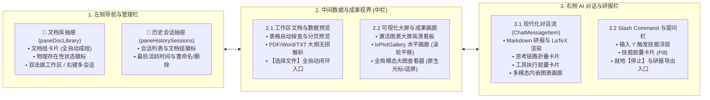

# Data Analysis Assistant UI 设计规范与交互设计文档

> **设计定位**：基于 WinUI 3 (Windows App SDK) 构建的桌面端专业级数据分析与智能研报助手界面。整体风格遵循 Windows 11 Fluent Design 设计语言，融入亚克力（Acrylic）与云母（Mica）材质，具备高质感、现代克制、严谨专业与沉浸式的交互体验。

---

## 一、 整体视界与布局架构

软件采用经典而高效的**三栏响应式流线布局**，从左至右职责清晰，信息流向自然连贯：

---

## 二、 左侧导航与管理栏 (`NavPane`)

左侧栏为用户提供数据资产（文档组）与知识资产（分析会话）的双抽屉收容与管理枢纽。

### 1. 文档库管理抽屉 (`paneDocLibrary`)
- **双重视角切换**：
  - **文档组卡片视角**：以“文档组”为单元聚合展示关联文件集（如 `sales 等2个文件`）。展示组内文件构成、总大小、创建时间与最后活跃时间。
  - **工作区文档视角**：扁平化展示当前激活组内的所有文档实体，支持关键词检索过滤。
- **物理存在性状态指示徽标**：
  - `✅ 正常`（绿色徽标）：本地文件路径有效可达；
  - `⚠️ 文件缺失`（黄色警告徽标）：当用户在磁盘移动或删除了原始文件时，UI 显式标记文件缺失，保留本地解析文本与 Schema 缓存，支持用户右键【重新定位原始路径】。
- **快捷交互规范**：
  - **鼠标左键双击文档组**：自动切换视图至【工作区文档】视角，高亮并完整呈现该组包含的所有文件，同时在中间栏自动激活预览首个文件；
  - **鼠标右键单击文档组**：弹出 `MenuFlyout` 上下文菜单：
    - `💬 基于此文档组新建对话`：支持为同一套文档组创建多个独立分析方向的会话（如“异常核查”、“增长预测”）；
    - `✏️ 重命名文档组`；
    - `🗑️ 删除文档组`（仅删除索引元数据，绝不破坏用户物理磁盘文件）。

### 2. 历史会话管理抽屉 (`paneHistorySessions`)
- **真实绑定**：绑定从 `%AppData%\DataAnalysis_Assistant\library\sessions\` 加载的本地持久化会话；
- **关联文档组徽标**：会话卡片上直观显示其绑定的文档组名称标签（如 `[财务2025组]` 或 `[独立会话]`）；
- **生命周期操作**：支持单击无缝切换会话、双击修改会话标题、右键删除会话确认弹窗。

---

## 三、 中间预览栏 (`CenterPane`)

中间预览栏作为数据探查与成果呈现的核心操作区，分为两个平行 Tab 页：【工作区文档】与【数据可视化】。

### 2.1 工作区文档与数据预览 (`gridDocPreviewView`)
- **多格式自适应解析引擎**：
  - **表格数据 (CSV / Excel .xlsx, .xls)**：自动嗅探编码（GB18030 / UTF-8）与分隔符，借助 `DataSchemaProfiler` 展现字段名、数据类型、缺失率与紧凑网格预览；
  - **PDF 电子文档**：基于 `PdfPig` 管道呈现提取文本与章节大纲导航；
  - **Word 研报 (.docx)**：基于 `DocX` 解析多级标题层级与正文；
  - **纯文本与代码 (.txt, .py, .json, .md)**：等宽字体着色呈现。
- **【选择文件】全自动闭环工作流**：
  - 位于中栏左上角的全局核心操作按钮；
  - 支持单选或多选批量导入；
  - **全自动流水线**：点击选择文件 ➔ 后台自动解析文本与生成 Schema 骨架 ➔ 自动依据文件名创建文档组（单文件去后缀，多文件按 `$"{首文件名} 等{总数}个文件"`） ➔ 自动新建同名会话并绑定 ➔ 工作区自动同步载入，中间预览首个文档，右侧就绪提问面板，全程无需繁琐手动建组。

### 2.2 数据可视化大屏与图表成果画廊 (`gridVisualizationView`)

#### 2.2.1 动态大屏看板展示
- **主图大屏展示区**：展示当前激活的高清统计图表，提供平滑过渡效果；
- **自适应双列底栏排版**：
  - 左列（自适应星号 `*`）：展示图表元数据与解读提示，开启 `TextTrimming="CharacterEllipsis"` 与 `TextWrapping="NoWrap"`，并配置悬浮 `ToolTip`，窄屏下绝不与右侧重叠；
  - 右侧操作栏（固定紧凑靠右）：严格遵守纯文本规范，提供【导出研报】、【放大】、【复制】、【另存为】四个纯净按钮。

#### 2.2.2 历史图表画廊 (`lvPlotGallery`)
- **水平画廊排列**：以缩略图形式横向陈列本会话生成的所有图表产物；
- **鼠标滚轮横向平移**：挂载 `PointerWheelChanged` 事件，将鼠标纵向滚轮滚动量无缝转换为水平平移（`ChangeView`），同时原生兼容笔记本触控板左右滑动手势；
- **状态高亮联动**：点击任意缩略图，大屏看板即刻无缝切换呈现该图。

#### 2.2.3 全局模态大图查看器 (`gridPlotImageViewer`)
- **默认全屏沉浸展开与复位机制**：
  - 每次打开查看器，窗口**默认以全屏模式沉浸展开**（支持点击【还原】平滑切换为 $1050 \times 720$ 居中窗口）；
  - **不记忆上次关闭前拉伸调整过的宽高状态**，重新打开始终保持全屏首选态，杜绝异形残留。
- **100% 完整展示整图算法 (Fit to Viewport)**：
  - 计算视口可用尺寸与图片物理自然尺寸的缩放比例：
    $$\text{FitScale} = \min\left(\frac{\text{ViewportWidth} - 28}{\text{NaturalWidth}}, \;\frac{\text{ViewportHeight} - 28}{\text{NaturalHeight}}\right)$$
  - 打开时、图片解码就绪时（`ImageOpened`）、视口拉伸时及点击复位比例按钮时，自动适屏居中，四周预留舒适呼吸内边距，彻底杜绝图表被局部裁剪截断。
- **透明边角热区与 Windows 原生双向拉伸光标**：
  - 界面本身没有任何可见文字、方块或图标抓手；
  - 左下角与右下角各布置 `36×36` 像素的纯透明感应热区（`Background="Transparent"`）；
  - 鼠标移入时由 WinUI 3 `ProtectedCursor` 机制直接呈现 Windows 原生拉伸光标：
    - **右下角**：`InputSystemCursorShape.SizeNorthwestSoutheast`（$\nwsearrow$）
    - **左下角**：`InputSystemCursorShape.SizeNortheastSouthwest`（$\ne-sw$）
  - **1:1 绝对中心跟手拉伸**：采用几何中心对称算法（$\text{Width} = 2 \times |\text{MouseX} - \text{CenterX}|$），卡片边缘实时精准紧贴鼠标指针尖端，无任何滞后延迟。
- **画布自由拖动平移 (Pan)**：
  - 按住 Ctrl 配合滚轮平滑缩放到细节（0.2x ~ 5.0x）；
  - 放大状态下，鼠标在画布区域呈现抓手光标（Hand），按住鼠标左键即可 1:1 自由拖动画布平移视口。
- **画廊顺序快捷切换、边界自动隐藏与键盘导航**：
  - 在放大画布左右居中位置悬浮一对 `44×44` 圆形半透明切换按钮（原生矢量箭头图标，无装饰 Emoji，全屏与还原尺寸模式下均紧贴视口两侧）；
  - 严格按画廊（`PlotGallery`）从左到右顺序切换上一张/下一张图表，切换时保持当前窗口/全屏态不变并将新图表复位为 `100%` 完整适屏；
  - 当画廊仅有 `≤ 1` 张图，或当前图表处于首/尾边界时，自动隐藏对应不可用方向的切换按钮；
  - 顶栏信息自动呈现 `当前序号 / 总数` 浏览进度，切换图表同步更新主看板及下方画廊高亮选中项；支持键盘 `←` / `→` 方向键切图与 `Esc` 键关闭查看器。
- **物理分列顶栏防重叠**：
  - 顶栏左侧图表标题与绝对文件路径设置自适应星号列与省略号截断（`TextTrimming="CharacterEllipsis"`），带悬浮 ToolTip；
  - 右侧紧凑固定操作栏：【在资源管理器中打开】、【100%】（点击复位）、【全屏】（全屏/还原切换）、【关闭】。
- **操作按钮纯文本规范红线**：
  - 彻底移除弹窗右下角冗余的【复制图片】与【另存为】按钮，垂直空间全量让渡给高清大图；
  - 所有按钮文字采用严谨纯文本，**严禁携带任何 Emoji 或装饰性图标**。

---

## 四、 右侧 AI 对话与研报栏 (`ChatPane`)

右侧栏是用户与数据分析智能体进行 CodeAct 推演交互的主阵地。

### 3.1 现代化对话流呈现
- **消息气泡设计**：区分用户气泡（品牌色背景、右对齐）与 Agent 回答卡片（卡片白/深灰背景、左对齐）；
- **推演链路与实时状态栏 (Reasoning / Live Status)**：
  - 深度推理内容**全程默认折叠**（包含思考进行中、完成态及历史会话恢复），仅当用户主动点击【展开思考】时才展开正文，生成结束时保持用户当前展开/折叠选择不强行打断阅读；
  - AI 思考阶段、Agent 轮次与工具执行状态（如 `正在深度思考...`、`第 X/Y 轮：正在执行工具...`、`已拦截高危 Python 代码`）**统一展示于上方 AI 消息气泡的思考状态栏**中，左侧配状态环与单行省略截断提示（悬停 `ToolTip` 完整查看），右侧为按需显示的折叠切换按钮；
  - 底部输入框左下角保持清爽，常驻 `Shift+Enter 换行，Enter 发送` 快捷键提示（仅在复制、导出等操作时短时呈现 3 秒操作回执后自动恢复）；
- **高危代码硬拦截警示 (Safety Gate Alert)**：
  - 一旦内置高危检测拒绝执行危险 Python 代码，立即在对应 AI 气泡内嵌入持久化红色 `InfoBar`（`Severity="Error"`）警示横幅，同时更新气泡思考状态栏并弹出纯文本原生 `ContentDialog`（“我知道了”按钮关闭）三重提醒用户；
- **工具调用卡片 (Tool Execution Cards)**：
  - 直观展示 Agent 发起的工具调用名称（如 `run_python`、`read_document`）；
  - 展开展示执行参数与返回输出摘要，支持代码一键复制；
- **多模态图表内嵌卡片**：
  - 回答中生成的所有统计图表直接在消息流内嵌呈现高清缩略图；
  - 单击即可唤起全局模态大图查看器全屏欣赏。

### 3.2 Slash Command (`/`) 技能扩展交互体系
- **浮层呼出与模糊检索**：
  - 当光标在提问输入框 `tbQuestion` 中且输入包含 `/` 前缀时，输入框上方自动弹出上拉浮层面板（`popupSkillSelector`）；
  - 面板陈列已安装技能：左列呈现 `</>` 图标，中列加粗显示技能名称（如 `nature-figure`），右列单行截断呈现浅灰功能简介；
  - 随键入字符实时进行动态过滤检索。
- **键盘导航零冲突规范**：
  - 浮层激活时，拦截键盘上下方向键（`Down` / `Up`）进行技能高亮选中移动；
  - 拦截 `Enter` 或 `Tab` 键确认选中技能；
  - 拦截 `Esc` 键平滑关闭浮层。
- **技能胶囊卡片 (Pill) 挂载体验**：
  - 确认选中技能后，自动擦除输入框内的 `/` 符号；
  - 在输入框左侧生成内嵌技能胶囊卡片：`[ </> 技能名  ✕ ]`；
  - 光标自然停留在输入框中，用户无缝继续输入具体业务问题；
  - 支持点击 `✕` 按钮或在输入框为空时按 `Backspace` 键快速移除当前挂载的技能。

### 3.3 研报一键专业级导出
- **导出入口**：消息气泡右上角提供【导出研报】与【复制正文】功能；
- **双格式支持**：
  - **专业 Word 研报 (.docx)**：排版包含文档封面大标题、生成时间、分析师签名栏、Markdown 标题映射、专业数据表格、代码高亮框及内嵌高清居中图表；
  - **标准 Markdown 研报 (.md)**：标准 Frontmatter 元数据与图表本地引用语法。

---

## 五、 UI 交互设计红线与质量约束清单

1. **纯文本按钮无 Emoji 纪律**：
   - 放大查看器弹窗、数据大屏看板操作栏、以及相关系统级操作按钮中，**严禁携带任何装饰性 Emoji/图标**（如 `🔍 100%`、`📋 复制`、`💾 另存为`、`🗖 全屏`、`✕ 关闭` 等）；
   - 一律采用克制、现代、高质感的**纯文本标签**（如 `100%`、`复制`、`另存为`、`全屏`、`还原`、`关闭`、`在资源管理器中打开`）。
2. **防穿透与排版自适应纪律**：
   - 所有承载动态路径或标题的顶栏/底栏网格，必须采用 `Grid.ColumnDefinitions` 物理分列；
   - 文本列设置 `Width="*"` 并开启 `TextTrimming="CharacterEllipsis"`，操作按钮列设置 `Width="Auto"`，杜绝窗口缩放时文本穿透重叠按钮。
3. **大图打开 100% 适屏纪律**：
   - 任何图表在放大查看器中打开时，首帧必须 100% 完整展现整图全貌，严禁默认只展现局部左上角；
   - 每次打开默认以全屏模式沉浸展开，并支持一键还原至 $1050 \times 720$ 居中标准窗口，不保留上次关闭前的异形尺寸。
